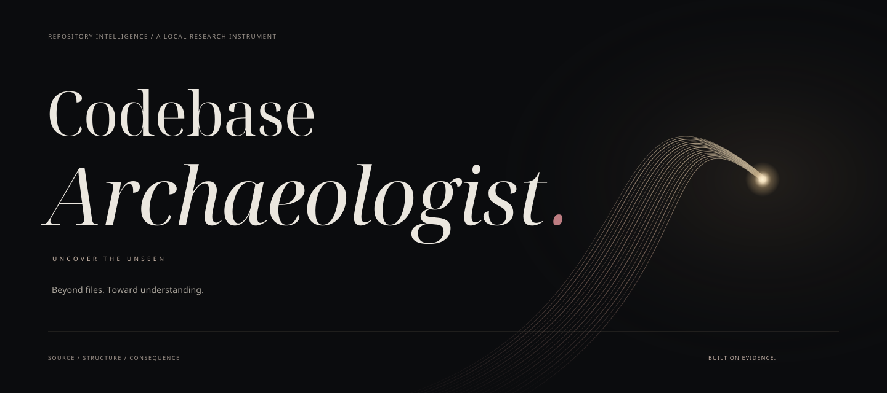

<p align="center"></p>

<p align="center"><strong>Built like an engineering platform. Designed for discovery.</strong><br />
A local repository intelligence instrument for understanding source structure, relationships and potential change impact.</p>

<p align="center"><a href="#open-the-workspace">Open the workspace</a> · <a href="#the-instruments">The instruments</a> · <a href="#research-with-the-caveats-in-view">Research evidence</a> · <a href="docs/frontend.md">Engineering documentation</a></p>

---

## Beyond the source.

A codebase is a system of decisions and dependencies—not just files in a folder.
Codebase Archaeologist transforms a secure ZIP or public GitHub snapshot into a coherent,
inspectable workspace. Analyze once. Move between structure, graphs, architecture,
heatmaps and potential impact with the same repository and stable entity identities.

**Evidence comes first.** No invented dependencies. No artificial quality percentage.
No repository code execution. Structural measurements, rule-based hotspots and C-only
research-model scores remain distinct, with explicit coverage and limitations.

## The instruments

| Workspace | What you can actually inspect |
| :-- | :-- |
| **Repository overview** | Provenance, language composition, physical/source lines, directories and searchable file inventory. |
| **Structural intelligence** | C/Python AST functions, complexity, nesting, span, parameters, decisions, loops and explained hotspots. |
| **Defect risk** | Real optional Random Forest C-function estimates, review priorities, filters, features and coverage. |
| **Knowledge explorer** | One extracted graph in interactive 2D/3D: hierarchy, calls and dependencies; search, filtering, overlays and evidence. |
| **Architecture atlas** | Real directory components, directed call/import/include aggregates and observed dependency-cycle groups. |
| **Repository heatmaps** | Nested source landscapes colored by six verified metrics, with drill-down, breadcrumbs and honest unscored states. |
| **Jordan** | Offline, deterministic engineering investigations with source references; optional consent-gated AI explanations of selected evidence. |
| **Time Machine** | Authentic pinned Git history: interactive timeline, UTC activity, nested churn, exact revision comparison and tracked-tree evolution. |
| **Blast radius** | Bounded 1–3 hop potential upstream dependents and downstream dependencies, with actual representative paths. |

The public homepage has an original procedural light composition and editorial typography.
Dedicated workspaces use a refined graphite/ivory instrument shell with restrained garnet
accents. Licensed fonts and visualization assets are locally served; analyzed data is
never sent to a visualization service.

## A real product, with real evidence

**Authentic application screenshots are still pending.** Neither Chromium nor Firefox reached
application rendering in this environment. The hero above is original brand artwork, not an application
preview. No fake screenshots or analytics are presented.

[Local screenshot and visual-verification checklist →](docs/screenshots/README.md)

## One analysis. A continuous workspace.

```text
/                              Cinematic public experience
/explore                       ZIP / public GitHub import
/workspace/overview            Repository context and inventory
/workspace/risk                C-only research-model intelligence
/workspace/structure           Function structure and hotspots
/workspace/graph               Hybrid 2D / 3D graph explorer
/workspace/architecture        Directory-component architecture
/workspace/heatmaps            Nested metric exploration
/workspace/blast-radius        Evidence-based potential impact
/workspace/jordan              Evidence-grounded engineering companion
/workspace/time-machine        Authentic Git history and revision exploration
```

These are separate Jinja documents with page-specific initialization—not one giant
dashboard hidden behind route names. A source-free snapshot lives in IndexedDB with a
per-tab active pointer. Refresh, deep links and normal back/forward navigation restore
that context without reuploading or reparsing.

Retention is bounded: **two hours, 24 MiB per snapshot, three snapshots per browser
origin**. A fourth tab context can evict an older snapshot. Expired records are pruned
on application storage operations; active pages also schedule expiry. Forget a snapshot
from the workspace. Browser data is not encrypted; avoid sensitive repositories on a
shared profile. No global server repository/session store or authentication is introduced.
See [workspace lifecycle and isolation](docs/frontend.md).

## Jordan. Questions with a source.

An engineering companion built on the repository's actual intelligence. Ask for complex
functions, callers, dependencies, component cycles or potential change impact. Inspect
stable-ID evidence and follow it into the existing workspaces. Ambiguous names produce
choices; missing information stays missing. Local mode needs no model download, API key
or internet connection and does not pretend to have retained source bodies.

Optional **AI-enhanced mode** uses an explicitly configured server-side OpenAI Responses
provider. Each request first shows its exact selected fact package; a separate consent
and send action is required. Questions, names, paths and metrics may be sensitive. No
archive, full analysis, full source or conversation history is disclosed. Cloud answers
are labeled interpretations, not verified facts, and are not persisted to conversation
storage. `store:false` is not a guarantee of zero provider retention. Local answers remain
available when the provider fails. Keys never enter browser assets or snapshots.

[Supported investigations, configuration, privacy and verification →](docs/jordan.md)

## Time Machine. Follow the changes.

A dedicated historical workspace retrieves real public GitHub history anchored to the
analyzed snapshot. Explore a zoomable commit timeline, UTC activity, nested file-churn
landscape, exact base-to-head revision comparisons and actual tracked-tree evolution.
Inspect parent evidence, reported renames, bounded literal patches and historical paths;
playback visits only loaded real revisions. Current-file links preserve exact identity
and keep current metrics separate from historical evidence.

Retrieval is explicit and bounded to **24 commits**, the first **100 changed files per
commit**, and **5,000 tree entries**. It uses fixed-host public GitHub REST requests,
not cloning; unauthenticated quotas and partial coverage are visible. ZIP imports have
an informative no-history state. No fabricated history, historical ML scores or provider
requests are introduced. Metadata shares the existing two-hour snapshot lifecycle;
comparison source patches remain transient and are never saved in browser snapshots.

Validated server evidence caching and request coalescing avoid repeated GitHub calls.
Loaded trees and short-lived comparisons are reused; quota/cooldown status and explicit
retry preserve the existing view on failure. Optional server-only `CODEBASE_GITHUB_TOKEN`
supports public-read authentication; no credential enters the browser. Anonymous operation
remains available, subject to GitHub's quotas.

[Methodology, limits, local browser acceptance and API →](docs/time_machine.md)

## Inside the instrument

```mermaid
flowchart LR
    ZIP[Repository ZIP] --> SAFE[Secure bounded extraction]
    GH[Validated public GitHub URL] --> DL[Trusted GitHub snapshot download]
    DL --> SAFE
    SAFE --> INV[Inventory and line metrics]
    INV --> AST[C / Python structural parsing]
    AST --> GRAPH[Resolved static knowledge graph]
    AST --> RF[Optional trusted C-function Random Forest]
    GRAPH --> ARC[Directory components and heatmap metrics]
    INV --> API[FastAPI analysis response]
    RF --> GRAPH
    RF --> API
    ARC --> API
    GRAPH --> API
    API --> STORE[Expiring source-free browser workspace]
    STORE --> PAGES[Dedicated intelligence workspaces]
    PAGES --> IMPACT[Bounded local impact queries]
    PAGES --> EXPORT[JSON evidence export]
```



Imported code is never executed or installed. ZIP traversal, symlinks, archive expansion,
file counts, source sizes and parsing work are bounded. GitHub URLs are validated and
requests use approved HTTPS endpoints with streaming limits, redirect controls and
explicit upstream errors. Temporary extraction resources are cleaned after requests.
Unresolved references never become confirmed graph edges.

## Open the workspace

**Ubuntu · Python 3.10+**. Node.js 18+ is used for frontend tests, not the application.
For the complete C parser and optional ML runtime, install the existing ML requirements:

```bash
sudo apt update
sudo apt install python3 python3-venv python3-pip git nodejs

git clone https://github.com/jordanonlycodes/Codebase-Archaeologist.git
cd Codebase-Archaeologist
python3 -m venv .venv
source .venv/bin/activate
python -m pip install --upgrade pip
python -m pip install -r requirements-ml.txt

# Once, with internet access: install the pinned local 3D bundle and license.
# Existing local assets need not be downloaded again.
python tools/install_graph_assets.py

python -m uvicorn app.main:app --host 127.0.0.1 --port 8000 --reload
```

Open **http://127.0.0.1:8000**. Enter the workspace, select a ZIP, then explicitly choose
**Analyze repository**. Or submit `https://github.com/owner/repository` for a public
repository's default-branch snapshot. The existing API also accepts trailing `/` and
`.git`; unsupported paths, credentials, schemes, hosts and query parameters are rejected.

Upload percentages represent actual transferred bytes. Processing is indeterminate;
there is no fabricated server progress. Errors preserve the previous active snapshot.
After success, explore all nine workspaces and export the current analysis as JSON.
Impact export additionally includes the selected bounded query.

A minimal static-analysis installation can use `requirements.txt`; missing optional
parser/model support is reported through coverage. Full C/Python/graph tests require
`requirements-ml.txt`. No GPU, React, Docker, database or cloud setup is required.

### Model artifact and offline operation

The trusted selected model belongs in **`artifacts/devign-v1/`**, intentionally ignored
by Git. A clone does not include model binaries or raw datasets. Restore the existing
trusted `pipeline.joblib`, `metadata.json` and `feature_schema.json` together; use a
compatible environment recorded in the model metadata. Optional operator setting:

```bash
export ARCHAEOLOGIST_MODEL_DIR=/absolute/path/to/trusted/devign-v1
```

Never point this at user-uploaded content. Joblib loading requires trusted local artifacts;
metadata checks are not a safety boundary for malicious serialized objects. If artifacts
are missing or incompatible, the application reports **model unavailable** and preserves
static analysis, structural intelligence, graphs, architecture, heatmaps and impact.
No training occurs at startup or during analysis requests.

The graph uses a locally installed **3d-force-graph 1.73.3** bundle (MIT; receipt/license
preserved by the installer). No CDN fallback is used. If the bundle or WebGL is unavailable,
the working 2D SVG adapter remains available. Fullscreen, quality controls, bounded
labels, deterministic perspective layouts, idle pause and renderer disposal support
integrated graphics. Performance mode leaves MSAA unrequested, caps pixel ratio at one
and disables the optional material emission. No measured FPS is claimed.

## Research, with the caveats in view

The recorded experiment uses the legitimate [CodeXGLUE/Devign dataset](https://huggingface.co/datasets/google/code_x_glue_cc_defect_detection),
revision `69bd48c03223c2104342acd9a807caf61ac3efb8`. Official splits are **21,854 / 2,732 /
2,732** train/validation/test functions. Audited cleaning yields **21,750 / 2,723**
development rows; all **2,732 test rows remain untouched**. Exact normalized overlaps and
conflicting development labels are handled by the documented leakage-safe policy.
The provider declares **C-UDA** for data; this is not a blanket license for every original
source project. [Manifest](reports/ml/source_manifest.json) · [Cleaning audit](reports/ml/cleaning_audit.json)

Eleven deterministic Tree-sitter C features are shared between training and inference.
Model selection uses validation F1. Recorded validation results:

| Model | Accuracy | Precision | Recall | F1 | ROC-AUC |
| :-- | --: | --: | --: | --: | --: |
| Logistic Regression | 0.545354 | 0.470652 | 0.365709 | 0.411597 | 0.537246 |
| **Random Forest** | 0.568491 | 0.503546 | 0.539696 | 0.520995 | 0.606784 |
| HistGradientBoosting | 0.548660 | 0.482014 | 0.509291 | 0.495277 | 0.574578 |

The selected Random Forest was evaluated once on the held-out test set:
**accuracy 0.555271 · precision 0.515267 · recall 0.537849 · F1 0.526316 · ROC-AUC 0.587354**.
Confusion matrix: **TN 842, FP 635, FN 580, TP 675**. These saved results are not rerun
for a website redesign. [Exact comparison](reports/ml/model_comparison.json) ·
[Held-out evaluation](reports/ml/test_evaluation.json) · [ML methodology](docs/ml_pipeline.md)

Performance is modest. Scores are **uncalibrated research estimates**, not confirmed
bugs, vulnerabilities or calibrated certainty. Prediction is C-only; Python and other
languages remain unscored. Structural hotspots are separate heuristics. Component and
heatmap model colors use the maximum actual function score, not an invented file or
repository defect probability. Static impact reachability does not establish breakage.

## Engineering and verification

FastAPI · Jinja2 · vanilla JavaScript · custom CSS · IndexedDB · SVG / Canvas ·
Tree-sitter C · Python AST · scikit-learn · pytest · pinned local WebGL graph bundle.

```bash
source .venv/bin/activate
python -m pytest -q
python -m pip check
node tests/frontend/graph.test.cjs
node tests/frontend/architecture.test.cjs
node tests/frontend/impact.test.cjs
node tests/frontend/workspace.test.cjs
# Real HTML + real mixed-language response integration:
python -m pytest tests/test_product.py -q -s
```

Baseline before Task 5: **385 passing Python tests**. The dedicated-page migration
passed **399**, and subsequent focused visualization checks passed **27**. **Final Task 5 verification: 402 passed, 0 failed, 0 skipped.** The browser-free
frontend checks include 29 real-document cases, 14 store/IndexedDB API-harness cases,
24 graph cases, 10 architecture cases and 32 impact cases, plus real-response smoke
checks. These are exercised through Python runners, not added to the Python total. Tests cover malicious ZIPs,
GitHub SSRF/streaming limits, metrics, model compatibility, graph resolution, evidence,
impact bounds, page initialization, snapshot isolation/expiry, cross-page identity,
import feedback and renderer/history cleanup. No security tests were removed.

**Task 6A verification: 435 Python tests passed, 0 failed, 0 skipped** (one existing
Starlette/httpx deprecation warning). Current browser-free checks include 44 real-document
journeys, 30 Jordan intelligence/retrieval cases and 15 snapshot-store cases, alongside
the preserved graph/architecture/impact suites. A real mixed ZIP smoke test analyzed
3 files / 4 functions, produced 2 genuine C-model scores and verified Jordan caller and
potential-impact evidence. All cloud provider tests used mocked responses; no live
provider success is claimed. [Jordan implementation and recovery record](docs/task6a_progress.md).

**Task 6B verification: 475 Python tests passed, 0 failed, 0 skipped**, with the same
existing deprecation warning. Genuine Git fixtures exercise seven commits, two author
display names, a merge, rename, deletion, binary data, shallow ancestry and exact revision
comparisons. Browser-free checks include 67 real-document journeys, eight Time Machine
view-model cases and 16 snapshot cases, alongside the preserved feature suites. No
live GitHub history or browser rendering is claimed in the socket/DNS-restricted sandbox.
[History methodology and acceptance](docs/time_machine.md) · [Task 6B progress](docs/task6b_progress.md).

**Task 6B.1 reliability verification: 502 Python tests passed, 0 failed, 0 skipped**.
The added cache, coalescing, credential-isolation and cooldown tests use deterministic
mocked HTTP over genuine Git fixture evidence. Browser-free journeys now include 77
cases. [Request-flow diagnosis, cache lifetimes and local verification](docs/task6b_rate_limit_fix.md).
Live GitHub/authentication and rendered visual acceptance remain unverified here.

Real browser verification is **outstanding**: Chromium exited 133 with a sandbox socket
error; Firefox exited 139 before rendering. No visual, responsive, genuine-WebGL or FPS
measurements are fabricated. [Frontend design and verification](docs/frontend.md) ·
[Task 5 implementation progress](docs/task5_progress.md)

## Field notes

- [Time Machine: authentic history, churn, comparison, evolution and coverage](docs/time_machine.md)
- [Jordan: local investigations, optional AI provider, explicit consent and limits](docs/jordan.md)
- [Secure GitHub ingestion](docs/github_ingestion.md)
- [Structural metrics and limitations](docs/structural_intelligence.md)
- [Knowledge graph extraction, perspectives and graphics controls](docs/knowledge_graph.md)
- [Architecture reconstruction and heatmap definitions](docs/architecture_heatmaps.md)
- [Blast Radius methodology, bounds and evidence](docs/blast_radius.md)
- [Inference/API contracts and artifact recovery](docs/inference_api.md)
- [Editable academic report](submission/Codebase_Archaeologist_Report.docx) · [Submission PDF](submission/Codebase_Archaeologist_Report.pdf)

The academic report covers its recorded Tasks 1–3A evidence; it was **not regenerated**
for this redesign. A comprehensive final report update is planned for Task 7.

Academic submission: **Bilal Malik · 24P-3061 · Software Engineering (SE), Class 5A ·
FAST-NUCES, Peshawar · 2026**. Individual project with instructor-approved solo participation,
as supplied by the student. No instructor identity is inferred.

Future work includes Repository DNA. They are **not
implemented** or shown as working navigation. Existing static-analysis limitations and
research caveats remain part of the product.

---

*Uncover the unseen. Keep the evidence in view.*
