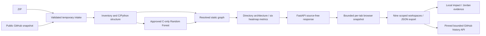
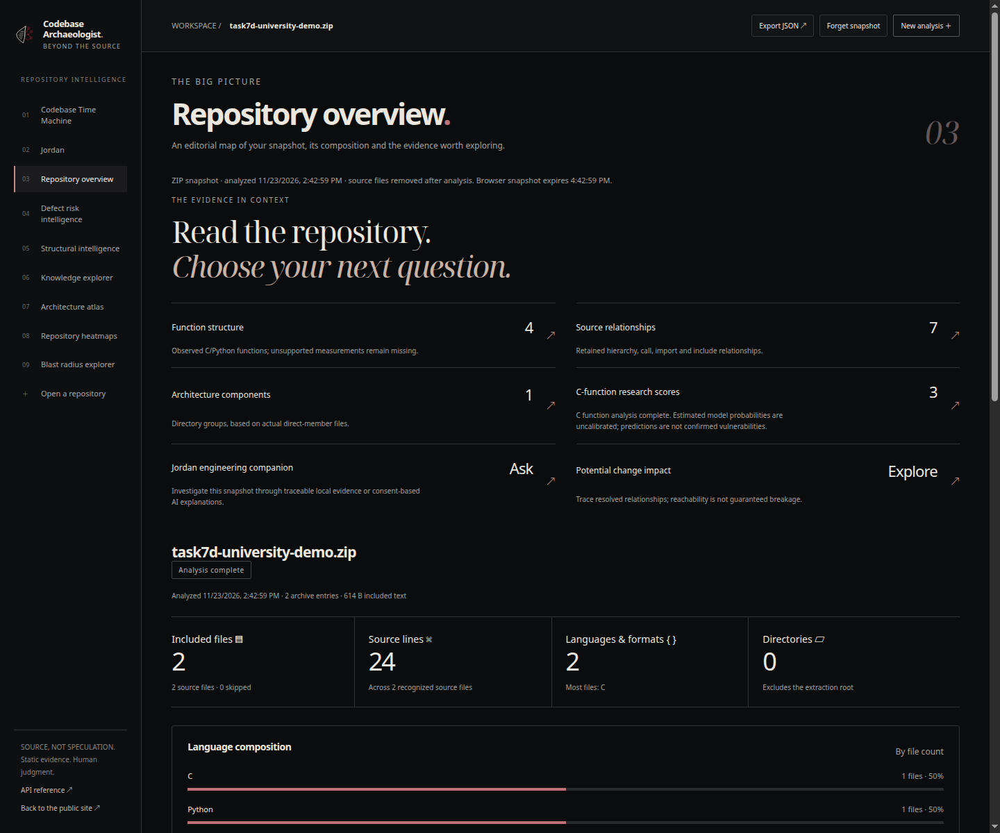
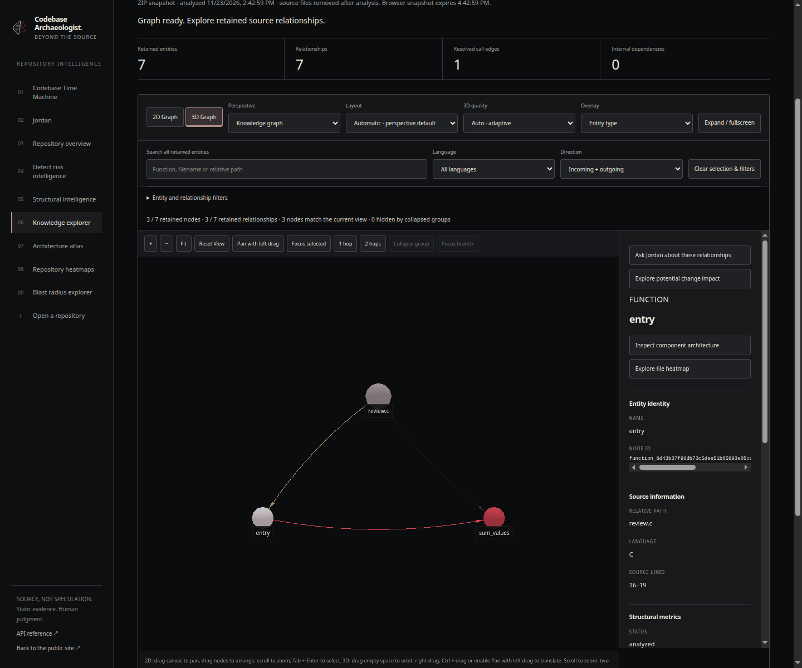
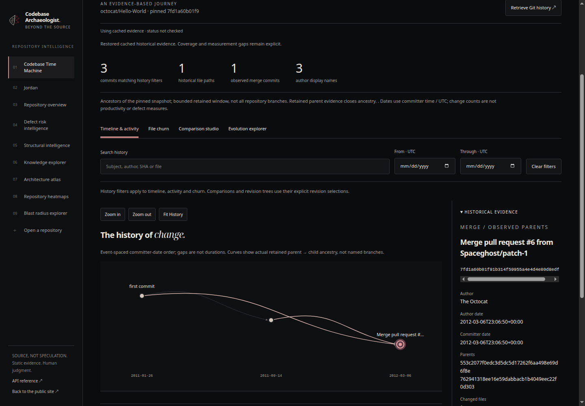

<p align="center"></p>

<p align="center"><strong>Codebase Archaeologist — AI-Powered Repository Intelligence & Defect Risk Analyzer</strong><br />
Inspect source structure, trace dependencies, investigate potential impact and explore real history.</p>

**Bilal Malik · 24P-3061**
**Aun Anis · 24P-3017**
FAST NUCES Peshawar · SE · AI-lab · M. Saad Khan · Semester 5 · 23 November, 2026

An instructor-permitted two-member university project. No individual roles are assigned.

## What the instrument does

Analyze a ZIP or public GitHub snapshot once, then move between dedicated workspaces
with the same repository and stable entity identifiers. Inventory, static structure,
rule-based hotspots, historical change and C-only research-model estimates stay distinct.
No imported repository program is executed. Missing evidence remains missing.

| Workspace | Implemented capability |
|---|---|
| Overview | Provenance, inventory, language/line composition and coverage. |
| Structure | C/Python function metrics, nesting, decisions, loops and hotspot reasons. |
| Risk | Genuine approved Random Forest estimates for eligible C functions only. |
| Knowledge Graph | Hierarchy, resolved calls/imports/includes; search, evidence and2D/optional3D. |
| Architecture | Actual directory components, directed aggregates and dependency-cycle groups. |
| Heatmaps | Six metrics, nested drill-down and explicit unscored/unavailable distinctions. |
| Blast Radius | Bounded1–3hop upstream/downstream potential impact with real paths. |
| Jordan Local | Deterministic, intent-aware repository questions and traceable evidence. |
| Time Machine | Real pinned Git history, activity, churn, revision comparison and evolution. |

Source-free IndexedDB snapshots expire after two hours (three snapshots,24MiB each).
This is browser-profile persistence, not an account system or encrypted private storage.
Exports reuse actual analysis. Cinematic motion respects reduced-motion preferences.

## Get started — recorded Linux runtime

The exact tested runtime is **Python3.14.10, Linux x86_64**. A separate29-package venv
and clean Git archive passed real model/API smoke checks. This is not certification of
all Ubuntu/Python versions. Ensure `python3.14 --version` identifies the intended interpreter.

```bash
git clone https://github.com/jordanonlycodes/Codebase-Archaeologist.git
cd Codebase-Archaeologist
python3.14 -m venv .venv
source .venv/bin/activate
python -m pip install -r requirements-runtime.lock
python tools/install_model.py
python tools/release_smoke.py --write-demo /tmp/university-demo.zip
python -m uvicorn app.main:app --host 127.0.0.1 --port 8000
```

Open **http://127.0.0.1:8000** → Explore a repository. Upload the generated demo ZIP or
submit a supported public GitHub URL. Model installation verifies/copies the exact local
artifact; it never downloads data or trains. No cloud key or research dataset is required.
If GitHub publication/networking is pending, use the release source archive instead of
cloning; follow the same commands inside its extracted directory.

The release venv was installed using byte-preserved cached wheels because terminal DNS
is restricted. Public-index installation and a fresh Ubuntu OS were not verified here.
See [isolated installation evidence](docs/task7d_clean_install_validation.md).

## Supported inputs and boundaries

- ZIP:25MiB upload,100MiB expanded,2MiB/file,5,000entries and bounded paths/depth/ratio.
  Unsafe traversal/links are rejected. Text/source exclusions and coverage are explicit.
- GitHub:validated public repository HTTPS URLs, bounded snapshot downloads, pinned SHA.
  This is not arbitrary URL fetching or an unrestricted private-repository service.
- C:structural parsing plus genuine function-model inference when the approved model loads.
- Python:AST structural analysis; **no C-model prediction**. Other languages have inventory
  coverage where recognized, not invented parser/model support.

[Ingestion](docs/github_ingestion.md) · [Structure](docs/structural_intelligence.md) ·
[API contract](docs/inference_api.md)

## The approved model — portable, with caveats

`models/devign-v1/` ships the exact4.3MiB production Random Forest with metadata/schema/
manifest. The installer populates the unchanged `artifacts/devign-v1` runtime path and
refuses a different existing artifact. `ARCHAEOLOGIST_MODEL_DIR` is an optional operator
path to trusted compatible artifacts; it is never controlled by repository uploads.

- Version:`devign-v1-4a23cc304ca8`;schema:`c-function-v1`;11numeric source-only features.
- Decision threshold:**score >=0.5**, including exact ties.
- SHA-256:`9988945c6c851e885f3942a406a4d6c7d704547797e266d6d0aed95520db74e6`.
- Joblib can execute code. Load only reviewed/trusted project artifacts. Digests detect
  changes but are not signatures. No endpoint accepts uploaded serialized models.

| Model | Validation accuracy | Precision | Recall | F1 | ROC-AUC |
|---|---:|---:|---:|---:|---:|
| Logistic Regression |.545354|.470652|.365709|.411597|.537246|
| Random Forest |.568491|.503546|.539696|.520995|.606784|
| Histogram Gradient Boosting |.548660|.482014|.509291|.495277|.574578|

RF was selected on validation F1. Its historical **previously exposed** test F1 is
**.526316**,ROC-AUC **.587354**. Only RF has that final-test evaluation. Scores are modest,
uncalibrated research estimates, **not confirmed bugs, vulnerabilities or safety guarantees**.

Task7C.0 evaluated11configurations/three grouped training folds/seven finalists. Enhanced
RF fixed-.5 F1 .534692 had lower AUC and failed the predefined gate. No replacement was
deployed. Always-positive validation F1 .606092 exceeds RF F1 but has zero specificity;
F1-only superiority/generalization claims would be misleading. Shared-origin/lexical
similarities and lack of independent confirmation remain limitations.

[Model portability](docs/task7d_model_portability.md) ·
[Complete optimization evidence](docs/task7c0_model_comparison.md)

## Dataset and research reproduction

CodeXGLUE/Devign C-function classification data:
https://huggingface.co/datasets/google/code_x_glue_cc_defect_detection

Pinned revision`69bd48c03223c2104342acd9a807caf61ac3efb8`. Official splits:
21,854/2,732/2,732. Cleaning retains21,750training/2,723validation;test unchanged.
113development removals and54conflicting-label groups are distinct quantities. The
later794-row overlap-filtered diagnostic is not an independent test. No raw dataset or
experimental candidate model binaries are shipped in the release.

Full acquisition/training/EDA instructions and license boundaries:
[research pipeline](docs/ml_pipeline.md). This is optional scientific reproduction,
**not required for inference**. Do not rerun test-based selection or claim a newly blind
holdout. The provider agreement is preserved with the model; see notices for rights limits.

## Architecture



FastAPI/Jinja2 templates, vanilla JavaScript/CSS, Tree-sitter C, Python AST and sklearn.
There is no React/Next.js, database, account system or required external AI provider.
[Frontend lifecycle](docs/frontend.md) · [Graph](docs/knowledge_graph.md) ·
[Architecture/heatmaps](docs/architecture_heatmaps.md) · [Impact](docs/blast_radius.md)

## 3D graph and third-party assets

2D and offline3D are included in the tracked source. The pinned npm1.73.3 distribution
is byte-verified, with its MIT license and conservative runtime dependency notices.
Run `python tools/verify_vendor_assets.py` to check the bundle and evidence. No runtime
CDN is used. See [3D provenance](docs/task7e_3d_asset_resolution.md).

## Jordan and historical exploration

Jordan Local uses retained metadata/metrics/paths, not full source-body understanding.
Ambiguous entities are disambiguated. Its existing optional cloud adapter remains
unconfigured/deferred for submission; configuration alone never grants transmission consent.
Do not paste API keys into repository questions. [Jordan boundaries](docs/jordan.md).

Time Machine requires genuine GitHub history; ordinary ZIPs show a no-history state.
Default scope is24commits,100files/commit and5,000tree entries with explicit truncation.
Immutable evidence uses bounded server caching/single-flight, client deduplication and
primary/secondary-limit handling. Comparison patches are transient; current ML estimates
are not historical scores. Optional server-only `CODEBASE_GITHUB_TOKEN` improves public
API authentication allowances but never guarantees unlimited quota. [History](docs/time_machine.md).

## Screenshots and academic report

**Authentic application screenshots are verified.** See the real Chromium captures below. No AI
mockups are presented as captures. Real Chromium rendering was verified in Task7E; the report
contains three provenance-checked Chromium screenshots.

- [Editable Word report](submission/Codebase_Archaeologist_Report.docx)
- [Matching-content PDF](submission/Codebase_Archaeologist_Report.pdf)
- [Capture/regeneration guide](docs/task7c_screenshot_capture_guide.md)
- [Current report acceptance](docs/task7d_report_acceptance.md)

Academic fields above are explicitly user-confirmed. Task7E adds actual Chromium interaction/viewport checks and isolated LibreOffice rendering.
Microsoft Word and physical GPU/FPS certification remain outside the verified scope.

## Tests and demonstration

```bash
# Full research/development environment; genuine local data prerequisites in ml_pipeline.md:
python -m pip install -r requirements-ml-frozen.txt
python -m pytest -q
node tests/frontend/graph.test.cjs
python tools/validate_report.py
python tools/check_report_links.py
python -m pip check
```

Node26.13.1 was used for frontend harnesses; it is not required to run the web app.
Runtime-only installs use `tools/release_smoke.py` rather than pretending all dataset-
dependent research tests can run without their prerequisites. Task7D baseline:**530passed**,
zero failed/skipped; final:**540passed**,zero failed/skipped. Results are in [release verification](docs/task7d_final_verification.md).
The217Node harness cases are invoked through Python tests and are not added to Python totals.
Existing Starlette/httpx deprecation warning is recorded. Restricted-sandbox selector
workaround is documented separately; normal local installations should use standard pytest.

[Short demonstration guide](docs/task7d_demo_guide.md) ·
[Submission package and checksums](docs/task7d_submission_manifest.md) ·
[University mapping](docs/task7d_university_compliance.md)

## Project structure

```text
app/                 FastAPI routes, analysis, ingestion, ML runtime, history, Jordan
app/templates/       Dedicated Jinja2 pages and shared workspace shell
app/static/          Scoped vanilla JS/CSS, fonts and Dependency Relic assets
models/devign-v1/    Approved exact model, schema, metadata and checksums
reports/ml/          Saved original/optimization scientific evidence
submission/          DOCX/PDF, report sources' manifests and candidate packaging
tools/              Model install/smoke, report generation and release builders
tests/               Backend, security, real Git fixtures and frontend harnesses
docs/                Architecture, scientific limitations and acceptance records
```

## Security, licensing and remaining work

Imported code is never executed. Bounded archive extraction, approved GitHub destinations,
source/work budgets, safe text rendering, trusted model loading and request cleanup remain.
Browser snapshots are not encrypted/authenticated private storage. No security/accessibility
certification or measured GPU FPS is claimed.

There is **no selected project-wide software license**. Dependency font/model/provider
notices are preserved in [THIRD_PARTY_NOTICES.md](THIRD_PARTY_NOTICES.md); GitHub visibility
does not imply blanket reuse permission. No secrets, raw datasets or unsupported models
belong in the submission archive.

Future work:independent project/time evaluation, stronger label/clone audits, calibration,
separately validated language-specific models and broader usability testing. These are
future possibilities, not current ML coverage or submission claims.

## Task7E acceptance evidence







These are genuine sandboxed Chromium157 captures: original mixed C/Python fixture and
octocat/Hello-World at7fd1a60b01f91b314f59955a4e4d4e80d8edf11d.
[Browser acceptance](docs/task7e_browser_acceptance.md) · [Release verification](docs/task7e_release_validation.md).

Task7E regression: **547 Python tests passed**, zero failed/skipped; **217 frontend harness cases**.
