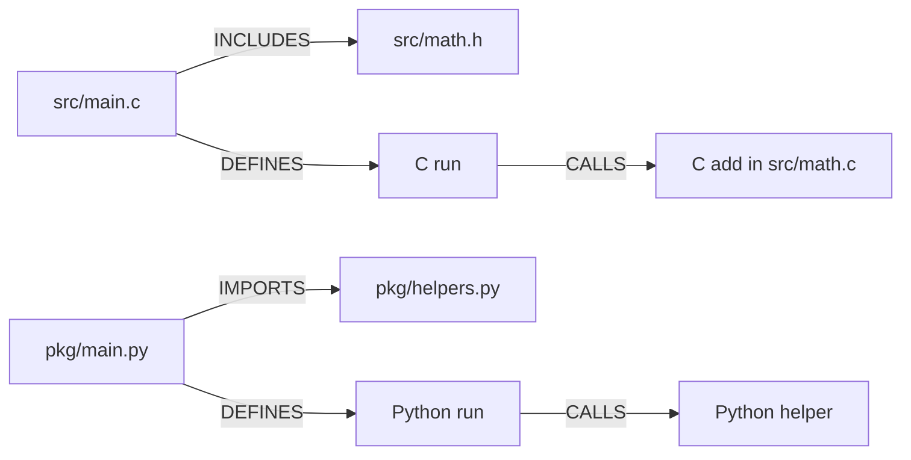

# Repository knowledge graph engine and explorer

The shared ZIP/GitHub analysis pipeline returns `knowledge_graph` (schema `1.0`).
The backend infrastructure now feeds the Task 4B.2 client-side explorer described below.
No dedicated graph endpoints are needed. No graph database, extra dependency, network request,
source execution, model training or persistent repository storage is involved.

## Architecture and contracts

`app/analysis/graph/` contains:

- `models.py`: dataclass response contracts and `GraphIndex` lookup helpers.
- `builder.py`: deterministic entities, deduplication, bounded output and summary.
- `languages.py`: bounded C Tree-sitter/Python AST evidence and lexical bindings.
- `resolution.py`: indexed symbols, module candidates and conservative resolution.
- `engine.py`: hierarchy, shared parse-cache consumption and aggregation.

`analyze_archive` runs inventory → structure → unchanged ML inference → identity
linking → graph. Both import methods use this function. C and Python trees are
reused from the request-local structural cache. Headers are parsed separately for
includes/declarations. Function definitions and identifiers come from structural
records, not an independent function discovery implementation. No source is retained
in graph output beyond bounded reference names/expressions.

The component contains `nodes`, `edges`, `references`, `summary`, `coverage`,
`limits`, and `schema_version`. Existing analysis fields and the frontend's whole-result
JSON export remain intact. The graph is available through existing analysis responses
and JSON export; Task 4B.1 added no visualization; the Task 4B.2 section documents the frontend adapters.

## Entities, identities and direction

| Node | Evidence and metadata |
|---|---|
| `repository` | Inventory-local snapshot identity; display name and verified `source` provenance |
| `directory` | Ancestor of an inventoried file; no fabricated empty directories |
| `file` | Existing structural file ID, inventory metrics, structural status/summary |
| `function` | Existing valid structural function ID, location, metrics, hotspot reasons, ML link when present |

Only functions with valid structural analysis are retained. Invalid/bounded definitions
remain visible in the original structural component and affect graph coverage.
Unsupported-language files still participate in hierarchy.

| Directed edge | Meaning |
|---|---|
| `CONTAINS` | Repository/directory → child directory/file |
| `DEFINES` | File → function (including nested definitions and methods) |
| `CALLS` | Caller function, or supported Python module scope → function |
| `IMPORTS` | Python file → internal module file |
| `INCLUDES` | C file/header → internal included file |

Every retained edge has existing endpoints and `status=resolved_internal`. This
means supported static evidence, **not guaranteed execution or runtime binding**.
Repository/directory/edge/reference IDs use SHA-256 over canonical, domain-separated
JSON values. File/function IDs are reused verbatim from Task 4A.2. Repository identity
uses sorted inventory paths, not a content digest or upload filename. These are
snapshot-local identities; they do not guarantee stability across edits or renames,
nor distinguish every revision with identical paths.

Edges aggregate by source, target, relationship type and reference spelling.
Different aliases may therefore produce separate edges to the same target. Each edge
retains occurrence count and up to eight line/column evidence locations (1-based
lines, 0-based UTF-8 byte columns). Excess evidence is flagged. Hierarchy edges occur
once. Unresolved occurrences are separate bounded records with deterministic IDs;
identical evidence uses a deterministic duplicate ordinal. Input inventory order does
not change output ordering or identities. No temporary absolute paths are exposed.

## C resolution

Direct identifier calls resolve to a unique same-file definition first. Cross-file
calls require a declaration in the caller file or a directly included, successfully
parsed repository header, and exactly one non-static definition. Static declarations
without a local definition never bind an external function. Duplicate definitions
remain ambiguous. Prototypes do not become function nodes. Parameter/local bindings,
file-scope callback objects, known macros and indirect expressions prevent direct-call
claims. Known macros from directly included headers also block resolution.

Quoted includes prefer the caller's directory. Otherwise an exact repository path or
unique path suffix is a supported candidate, including angle-bracket includes;
multiple candidates are ambiguous. This does not establish compiler search-path
precedence. Macro include expressions are unsupported. Missing internal header parse
results conservatively prevent call resolution in that including file.

There is no C preprocessing, linker/type checking, build-flag interpretation, macro
expansion, transitive header expansion or function-pointer analysis. Conditional
compilation is not evaluated. Inline definitions in `.h` files have no structural
function records and are not extracted as graph functions. Included external headers
may introduce unknown macros; resolved calls are evidence within this limited static
model, not compilation guarantees. Malformed C files retain hierarchy/valid structural
nodes but produce no semantic references, even if individual AST fragments survived.

## Python resolution

Named function/method records retain lexical qualified names. Calls in nested
functions belong to those functions, not their parents. Module/class-body calls use
the enclosing module/function node; methods have their own nodes. Class namespaces
are not inherited as lexical method scopes.

Supported calls include direct lexical/same-module functions, recursion, imported
internal functions, aliases, module-qualified functions and relative imports.
Candidate module names come from inventory-relative paths, evidenced `__init__.py`
package chains and conventional `src/` layouts. All matching candidates are considered;
ambiguous roots, duplicate `.py`/`.pyi` modules and duplicate definitions are not guessed.
No repository module is imported and `sys.path` is never modified.

`from pkg import child` prefers an actual child module when evidenced and unambiguous;
a competing package binding remains ambiguous. `from module import function` records
a dependency on the containing module. Re-export chains are not followed. Namespace
package directory nodes are not invented as module files; imports with no concrete
module file may remain unresolved even when a qualified function call can be resolved.

Parameters, assignments/deletions, exception names, match captures, conditional
bindings, `global`/`nonlocal`, wildcard imports and duplicate bindings are handled
conservatively. Decorated definitions are not assumed to preserve callable identity.
`exec`, `eval`, namespace mutation helpers and arbitrary attribute dispatch block
supported local resolution. Comprehension calls are recorded but unresolved because
of their implicit scopes. Lambdas, definition-time defaults/annotations/decorators
and class bases are outside call coverage. Runtime monkey patching, arbitrary
`sys.path` changes, dynamic dispatch, assignment aliases, callbacks and method target
inference are not implemented. Direct recognized dynamic import expressions produce
`unsupported_dynamic` dependency records; indirect aliases of dynamic import helpers
cannot always be identified as dependencies.

## Uncertainty, structural and ML metadata

No external entity definitions are fabricated. `references` holds:

- `unresolved`: no supported unique target; **not proof of a third-party dependency**.
- `ambiguous`: competing candidates or bindings.
- `unsupported_dynamic`: indirect/dynamic/blocked binding or unsupported syntax.

These records include source node, relationship type, bounded spelling, evidence and
reason code. They are not resolved edges and have no invented target/source location.

Function metadata copies structural measurements and centralized hotspot reasons
(current thresholds: complexity ≥11, depth ≥4, span ≥80, parameters ≥6). Graph extraction
does not recompute them. C nodes reuse `ml_result_index`, `ml_status` and actual
available class/probability fields. Python, directories and unsupported files receive
no ML score. ML estimates remain uncalibrated research outputs, not confirmed defects
or vulnerabilities. Neither complexity nor graph degree is a validated defect score.
Graph extraction remains operational with missing model artifacts.

## Coverage, counters and limits

Summary counts describe **retained** nodes, unique edges and reference occurrences.
Resolved call/dependency occurrence totals are separate from unique edge totals.
`unresolved_call_references` includes all nonresolved call statuses; dependency counts
likewise include ambiguous/dynamic records. `observed_references` counts extracted
occurrences, including evidence in a file later discarded due to a limit. It is not
an estimate of undiscovered references.

Eligible files are `.c`, `.h`, `.py`, `.pyi`. Analyzed files completed supported AST
extraction; skipped files failed or hit bounds. Unsupported source files retain
hierarchy. `complete` means the defined extraction subset completed for included
source files with no coverage issue; it does not promise complete language semantics,
all runtime dependencies, or coverage of ingestion-excluded files. Unresolved references
alone do not mean parsing was incomplete. `truncated` and controlled `issues` codes
explicitly report resource loss. File work/symbol/reference failures discard that
file's semantic facts, preserving other files and hierarchy. Structural partial
coverage is also reported.

Central `GraphLimits` in `app/config.py` (no new environment variables):

| Bound | Default |
|---|---:|
| Source per file / total | 512 KiB / 8 MiB |
| Traversal per file / total | 100,000 / 400,000 AST nodes |
| Graph nodes / unique edges | 12,000 / 20,000 |
| Function index / retained symbol bindings | 4,000 each |
| Observed reference occurrences / unresolved retained | 12,000 / 4,000 |
| Evidence locations per edge / reference spelling | 8 / 256 characters |
| Serialized graph budget | 12 MiB |

Function records also obey existing structural limits (2,000 functions). Inventory
and path indexes inherit ingestion bounds (5,000 entries, depth 30, 240-byte paths).
Temporary per-file bindings are bounded by source/traversal limits; retained symbol
bindings have a separate cap. References use indexed lookup with request-local caches,
not all-pairs function matching. Traversal is iterative. Parser allocation itself is
bounded by source size, not a process-isolated hard CPU/memory deadline.

Output accounting uses non-indented ASCII-escaped JSON with a reserved 16 KiB envelope
(minimum configurable output budget). Pretty-printed JSON export may be larger but
remains bounded by these retained data limits. No graph content is executed, installed
or fetched. Existing extraction limits, containment checks and temporary cleanup
continue to apply.

## Small verified example

Use these six files (include final newlines on preprocessor directives):

```c
// src/math.h
int add(int x);
// src/math.c
int add(int x){return x+1;}
// src/main.c
#include "math.h"
#include <stdio.h>
int run(int x){printf("review");return add(x);}
```

```python
# pkg/__init__.py: empty
# pkg/helpers.py
def helper(x):
    return x
# pkg/main.py
from .helpers import helper
def run(x):
    return helper(x)
```

The actual ZIP smoke test retained 13 nodes (1 repository, 2 directories, 6 files,
4 functions), 16 edges (8 CONTAINS, 4 DEFINES, 2 CALLS, 1 IMPORTS, 1 INCLUDES), and
2 unresolved references (`stdio.h`, `printf`). All six eligible files completed,
without truncation. The local trained model analyzed the two C functions; Python
received structural/graph results only.



This diagram shows semantic edges and selected definition edges; the JSON also
contains the complete retained hierarchy. Unresolved references are not drawn as
confirmed edges.

## Reuse and local verification

`GraphIndex(graph)` offers `node(id)`, `nodes_of_type(type)`,
`incoming(id, kind=None)` and `outgoing(id, kind=None)`. Building it is O(V+E).
Future neighborhood/impact traversal must track visited IDs to handle recursion and
cycles. No impact algorithm or architecture classifier is implemented. Directory-based architecture aggregation is documented separately below. The graph UI is described below.

```bash
source .venv/bin/activate
uvicorn app.main:app --reload
# In another terminal, after creating a small fixture ZIP:
curl --fail -F file=@/path/to/fixture.zip http://127.0.0.1:8000/api/analyze > /tmp/analysis.json
python -c 'import json; r=json.load(open("/tmp/analysis.json")); print(r["knowledge_graph"]["summary"])'
pytest tests/test_graph.py tests/test_github.py -q
pytest -q
```

Upload the same ZIP in the existing dashboard and export JSON; confirm its
`knowledge_graph` component, structural section and C-only ML results. A public GitHub
import uses the same engine; compare graph content after excluding repository-node
name/source provenance. Use the explorer below for client-side visualization.

Task 4B.1 verification: 69 focused graph cases and the complete 348-test suite passed
(0 failed, 0 skipped), including mocked GitHub/ZIP graph equivalence, existing security
regressions, unchanged structural/ML results and model-unavailable behavior. One existing
Starlette TestClient deprecation warning remains. Tests in the restricted environment
used a process-local selector polling workaround; normal local runs use the commands
above. Uvicorn completed application startup but the environment denied binding
`127.0.0.1:8765`, so browser and live-network UI verification were not performed.


## Interactive explorer (Task 4B.2)

The explorer consumes the existing analysis response locally. It adds no graph API,
persistent repository storage or external data service. The backend retains its
original semantics and resource limits documented above.

| Frontend module | Responsibility |
| --- | --- |
| `data.js` | Canonical IDs, indexes, filters, full-retained-node search, bounded traversal |
| `layouts.js` | Deterministic positions, collision checks, directional emphasis and label selection |
| `explorer.js` | Shared state, controls, counts, coverage, text-only inspector and renderer lifecycle |
| `svg.js` | Retained SVG scene, pointer/keyboard controls and scheduled updates |
| `three.js` | Optional local WebGL adapter, fixed spatial positions and bounded graphics work |

Canonical backend objects are never handed to the mutating 3D library directly.
Both adapters share selected ID, perspective, layout choice, query, filters, overlay,
branch/neighborhood focus and direction. Switching renderers does not submit another
analysis. Camera and dragged positions are adapter-local; a renderer switch may arrange
nodes again. Repository replacement disposes the old renderer and resets interaction state.

### Perspectives and directions

| Perspective | Visible entities | Directed relationships |
| --- | --- | --- |
| Knowledge | Repository, directories, files, functions | Chosen retained edge types; hierarchy follows CONTAINS and DEFINES |
| Function Calls | Functions | CALLS from caller to callee |
| Dependencies | Files | IMPORTS/INCLUDES from importing/including file to dependency |

A selected caller's outgoing links identify callees; incoming links identify callers.
For dependencies, outgoing links identify files depended on, and incoming links identify
dependent files. Direct links, plus relevant indirect links in a focused one/two-hop
subset, are highlighted in the requested direction. Self-recursion and cyclic calls or
dependencies remain actual edges. Repeated-call occurrence counts are preserved.
Positions and highlighting do not establish a runtime execution order.

Unresolved, ambiguous and dynamic references stay in the inspector, with no fabricated
internal targets. A filtered, collapsed or bounded view is not the complete retained
graph; JSON export still contains the backend result independently of UI state.

## Layout and rendering refinement

### Perspective-specific algorithms

| Layout setting | Knowledge | Calls | Dependencies |
| --- | --- | --- | --- |
| Automatic | Packed containment subtrees | Directed SCC layers | Directory clusters |
| Hierarchical | Packed containment subtrees | Directed SCC layers | Directed SCC layers |
| Radial | Concentric rings | Concentric rings | Concentric rings |

- **Packed hierarchy:** uses actual CONTAINS/DEFINES ancestry. Subtree bounds are computed
  bottom-up; child subtrees are packed into at most four columns with explicit gaps.
  Repository roots, directory groups, files and their definitions stay associated.
  When filters hide a container, positioning may use the nearest evidenced visible
  ancestor; no replacement edge is invented.
- **Directed layers:** iterative Kosaraju traversal finds strongly connected components.
  The component graph is layered from upstream sources toward downstream targets.
  Mutually recursive functions or circular dependencies share a component/layer and
  retain their individual nodes and edges. Disconnected components are retained.
- **Directory clusters:** dependency files are grouped by their normalized parent
  directory, then placed in spaced grids. Grouping describes actual paths, not inferred
  Python runtime import roots or architecture components.
- **Radial:** deterministic concentric rings use increasing radius and bounded capacity
  to leave room between entities. This arrangement does not imply semantic proximity.

A neighboring-cell collision check separates positions that are too close in the
bounded layout. Selection and overlay changes preserve positions. Membership changes
reuse cached positions where possible; adding entities can cause collision adjustments.
A perspective/strategy change or Reset may recompute the layout. Users can intentionally
drag nodes into overlap, and no layout guarantees crossing-free edges.

### Hierarchy groups and focused exploration

Knowledge views with more than 180 retained entities initially collapse file groups.
Select a directory, file or repository and use **Collapse group / Expand group**;
**Focus branch** follows actual descendants within the visualization bound. Collapsing
a group clears query/neighborhood focus so the change takes effect. Hidden-by-group
counts remain visible. Functions can still be found through full-index search.

Typing a query searches names and relative paths after a 160ms debounce and fits the
matching view. The accessible browser lists up to 40 retained hits independently of
active view filters. Selecting a hit clears incompatible type/language restrictions,
opens its neighborhood and focuses it; existing relationship filters still apply.
Related-node inspector buttons use the same selection path.

One/two-hop traversal is cycle-safe and direction-aware. Perspective changes explicitly
reset entity, relationship and language filters, clear incompatible selection/focus and
show a notice; query, layout and overlay remain. Layout changes do not clear these
controls. Clear selection/filters resets shared interaction state except rendering mode and
3D quality preference.

### Node, edge and overlay legends

2D uses repository diamonds, directory squares, file rectangles and function circles.
Their relative size values are 14 / 10 / 8 / 6; 3D uses type-sized spheres, not those
four 2D shapes. Sphere volumes derive from the same type values, with a 1.4× factor
for actual structural hotspots. Size is not an importance, centrality or quality score.

| Relationship | Neutral color | 2D line style |
| --- | --- | --- |
| CONTAINS | Gray | Dashed |
| DEFINES | Mauve | Dashed |
| CALLS | Pale crimson | Solid |
| IMPORTS | Green | Solid |
| INCLUDES | Amber | Dashed |

3D uses thin colored lines and directional arrows rather than per-edge cylinders;
dash patterns are a 2D distinction. Selected outgoing edges are crimson, incoming
amber, and unrelated edges are dimmed. Self-loops belong to both directions and use
outgoing color when both are active. Curves distinguish self-recursion and parallel or
opposite-direction relationships where practical. Hover content includes relationship
type, reference and occurrence count. Inspector relationship entries expose all retained,
bounded evidence locations, including path, line and column.

Overlays retain the existing interpretation:

- **Entity:** colors/shapes or relative sphere volumes distinguish node types.
- **Complexity:** measured low/moderate/high/very-high bands use green/amber/crimson/
  magenta; missing measurements are gray. Hotspot markers use existing threshold reasons.
- **ML:** only genuinely analyzed C functions receive class colors: crimson for predicted
  defect-related, green for predicted non-defect-related. Gray means unscored. The
  inspector labels model probability as an estimated, uncalibrated research output.

Python, directories, files and repositories receive no fabricated ML probability.
Neither graph connectivity nor structural thresholds nor model estimates prove a defect
or vulnerability. No feature attribution or aggregate repository defect score is invented.

### Contextual labels and inspector

Selected and hovered entities receive label priority; nearby relevant entities are
preferred over unrelated ones. Ordinary labels are collision-suppressed, additional
2D labels appear as zoom increases, and long names are abbreviated visually. Complete
names remain available through native titles/3D hover content and the inspector.
Forced relevant labels can still overlap; camera focus and neighborhoods help.

Inspector groups depend on entity type: identity/source for repositories and directories,
file structural summaries for files, and function metrics/hotspots/ML for functions.
Incoming and outgoing relationships and unresolved callable/dependency references are
separate groups. Full source code is not available. Missing metrics say Unavailable;
zero measurements remain zero. IDs have their own horizontally scrollable monospace
field; ordinary content uses the application typeface, and long paths remain accessible.
All repository-controlled values are inserted as text.

### Rendering optimizations and graphics preferences

SVG reconciles keyed node/edge elements when membership changes. Geometry, styles and
viewport updates are separate. Selection/overlay changes do not rebuild the scene;
pointer-driven geometry and viewport work are coalesced through requestAnimationFrame.
Wheel zoom anchors at the pointer, panning uses viewport coordinates, and fit/reset
respect the viewport aspect ratio.

3D extends shared layout coordinates into modest type-separated planes and fixes
coordinates; force simulation warmup/cooldown are zero. A topology/layout signature
prevents unchanged graph submissions. Selection/overlay changes retain graph objects
and positions while updating presentation. Labels are reused, projected only while
awake and throttled to at most one pass per 50ms.

The **3D quality** selector offers Auto (default), Performance and Balanced. Its
settings apply across Knowledge, Calls and Dependencies without changing 2D SVG,
selection, layout, filtering or source relationships. The preference survives renderer
and repository switches and filter clearing for the page session; reload defaults to Auto.

| Setting | Auto initial | Performance | Balanced |
| --- | --- | --- | --- |
| Pixel-ratio cap | 1.25 | 1 | 1.5 |
| Sphere mesh resolution | 6 | 4 | 6 |
| Label candidates / normal budget | 28 / 16 | 20 / 12 | 40 / 24 |
| Minimum label projection interval | 75ms | 100ms | 50ms |
| Arrowheads | All displayed edges | Selected/hovered/focused relationships | All displayed edges |
| MSAA request | Off | Off | Off |

Pixel ratio is the lesser of device pixel ratio and the profile cap. Performance
requests fewer arrowheads to reduce geometric work; **all displayed edges remain**,
and direction/reference information stays available in hover and inspection. Focused
incoming/outgoing relationships retain arrows. Node types, overlays and hotspot meanings
do not change. Switching quality changes resolution/geometry only when the effective
profile changes; it does not replace graph data, recalculate layout or recreate the
WebGL context. Auto can downgrade to the Performance row as described below.

Common settings: `antialias: false` in both the renderer and capability probe,
`low-power` renderer preference (a browser hint), thin edge lines, arrowhead resolution
3, arrow length 3 where enabled, zero force simulation and no camera damping. The status
line reports effective settings and the actual context antialias attribute when available;
requesting antialias off is not a claim about every driver/compositor stage.

SVG labels use the existing contextual budgets (normally 32, 70 above scale 1), with
collision suppression. The 2D adapter does not create a WebGL context. Canvas interaction,
selection, resize and camera controls wake 3D rendering for a normal 220ms window;
focus/fit extend it for their transitions. Resume is requested once per awake period.
Idle/offscreen rendering pauses, and hidden documents stop the sampling/render loop.
Reduced motion makes camera transitions immediate. No bloom, custom shaders, particles
or browser-security changes are involved.

### Hardware feedback and adaptive quality

The user reported manually testing the application on:

- Intel HD Graphics 620 (Kaby Lake GT2).
- Arch Linux, Hyprland and Wayland; Mesa 26.2.7.
- Chrome 155 using ANGLE/OpenGL, at 1366 × 768.
- Hardware-accelerated WebGL, WebGPU, canvas, compositing and rasterization.
- Zero reported GPU process crashes.
- Chrome GPU diagnostics containing `msaa_is_slow` and `msaa_is_slow_2` workarounds.

These are **user-reported observations**, not an independently reproduced benchmark.
The workarounds identify a reason to inspect multisampling requests. They do not show
that this graph was multisampled, quantify a cost or establish the cause of stuttering.
Zero crashes and acceleration availability do not establish smooth frame delivery.
The renderer already requested antialias off before this follow-up; the capability
probe previously used default attributes and now explicitly requests it off as well.
No vendor string, GPU model or operating-system rule is used to choose quality.

Auto samples browser animation-frame callback intervals only while the adapter is
awake. Each window contains 24 intervals; if the median exceeds 28ms in two consecutive
windows, the profile steps down to Performance. Pausing resets the previous timestamp,
so idle gaps are not sampled. Normal windows reset the slow-window streak; isolated
outliers do not dominate the median. Auto does not step back up during that renderer
session, avoiding quality oscillation. Choose Balanced explicitly, or change away from
and back to Auto, to retry; a new renderer starts sampling afresh.

This is a coarse responsiveness heuristic, **not GPU profiling or a measured FPS
improvement**. CPU work, scheduling, browser behavior or other load can also produce
slow intervals. Manual Performance/Balanced choices are not overridden. No browser
flags, disabled security features, OS configuration changes or new dependencies are
required. Real behavior on the reported hardware still needs comparative profiling.

### Lifecycle and resource limits

Adapters initialize lazily when needed. Only one renderer exists at a time; stale async
asset loads cannot attach after a mode/repository switch. SVG destruction cancels its
scheduled frame and removes listeners and retained elements. 3D destruction cancels
wake timers/label frames, disconnects its observer, removes canvas listeners/callbacks,
disposes controls, geometry/materials/textures, renderer/context and the pinned component.
Controller-level observers remain attached to the persistent explorer container.

| Frontend bound | Value |
| --- | --- |
| Displayed nodes / edges | 180 / 420 |
| Search results / inspector links or references per group | 40 / 40 |
| Neighborhood | 1 or 2 hops; 180 nodes; 6,000 relationship visits |
| Search debounce | 160ms |

Displayed, matching, retained and collapsed-group counts have distinct meanings.
Backend truncation and skipped/unsupported-file coverage remain visible. Limits can
omit relationships from the visualization; retained backend counts and JSON export
must be consulted for the larger result. No result completeness or speed percentage
is derived from these counters.

### Setup, dependency and browser compatibility

2D uses local SVG/JavaScript with no new package. 3D expects the local UMD bundle for
**3d-force-graph 1.73.3**, including Three.js. Install once with network access:

```bash
source .venv/bin/activate
python tools/install_graph_assets.py
python -m uvicorn app.main:app --host 127.0.0.1 --port 8000 --reload
```

The installer validates package identity, reads bounded named archive members, preserves
LICENSE and writes a hash/dependency receipt in `app/static/vendor/`. No npm scripts
or build step run. Preserve license notices and the receipt when redistributing assets.
The receipt documents downloaded bytes; it is not an independent signature. See the
[local asset notes](../app/static/vendor/README.md),
[upstream API](https://github.com/vasturiano/3d-force-graph) and
[pinned license](https://github.com/vasturiano/3d-force-graph/blob/v1.73.3/LICENSE).
The application fetches local assets only and sends no repository data to a graph service.

Fine-pointer desktops at least 1000px wide prefer 3D when WebGL is detected and reduced
motion is off. Other devices start in 2D. Missing bundles, failed WebGL detection or
renderer initialization errors produce an explicit 2D fallback. Feature detection alone
does not establish compatibility with the bundled renderer. Reduced motion disables
camera transitions, and accessible search/related-node buttons support selection in
both modes. 2D additionally supports Tab/Enter/Space node selection and arrow-key pan.

The frontend targets browsers providing SVG, Pointer Events, ResizeObserver,
IntersectionObserver, matchMedia and modern JavaScript; 3D additionally needs a working
WebGL renderer. No tested browser/version matrix is available. A custom 3D layout is a
static arrangement, not a force simulation. Dense graphs can still cross edges or hide
labels. Responsive CSS, orbit/drag behavior, real GPU operation and low-power behavior
remain unverified in this environment.

Initial dependency downloads were blocked by DNS. During refinement, local 1.73.3
assets were present and the bundle matched its receipt; those untracked user files
were preserved unchanged. Chromium startup failed with `setsockopt: Operation not
permitted`; localhost port binding was also blocked. No successful visual, live-GitHub
or real-WebGL verification is claimed. Graph semantics retain all static-analysis
limitations described earlier. Semantic architecture classification and impact analysis remain future work; Task 4C.1 now adds evidence-based directory-component reconstruction.

### Local functional and performance verification

Run on an unrestricted local machine. Use a small known mixed-language repository
and a larger fixture within the ingestion limits. Keep the same ZIP, browser version,
viewport, device-pixel ratio and hardware when comparing observations.

```bash
source .venv/bin/activate
node tests/frontend/graph.test.cjs    # Node.js 18+, no npm packages
pytest tests/test_graph_explorer.py -q
pytest -q
python -m uvicorn app.main:app --host 127.0.0.1 --port 8000 --reload
```

1. Open `http://127.0.0.1:8000` and analyze the fixture. Exercise all six combinations:
   2D/3D × Knowledge/Calls/Dependencies. Record retained and displayed counts for each.
2. Check containment groups, collapse/expand, branch focus and search for hidden functions.
   Verify caller/callee and dependency arrows against source. Inspect recursion, cycles,
   occurrence counts and unresolved references without assuming runtime execution.
3. Try every layout and overlay; confirm selection/overlay changes preserve positions.
   Check pointer-anchored 2D zoom/pan, dragging, fit/reset, 3D orbit/pan, keyboard selection,
   narrow viewports, reduced motion and missing-WebGL/asset fallback.
4. Use browser developer tools Performance recording during a fixed sequence of selection,
   overlay, pan, zoom and dragging. Compare layout/DOM work, frame timing and long tasks
   on the same fixture; distinguish initial layout cost from steady interaction.
5. Before and after a **selection/overlay-only** change, inspect the existing development
   counters in the console:

   ```javascript
   const a = window.graphExplorer.adapter;
   ({layoutRuns: a?.layoutRuns, graphDataUpdates: a?.dataUpdates,
     displayedNodes: window.graphExplorer.view.nodes.length,
     displayedEdges: window.graphExplorer.view.edges.length});
   ```

   Layout runs should remain unchanged; 3D graph-data updates should remain unchanged.
   SVG has no graph-data counter. Layout/perspective/membership changes or a new adapter
   can legitimately change/reset counters. They are diagnostics, not FPS measurements.
6. Check 3D idle/offscreen behavior and repeated repository/mode switches with the browser's
   performance/memory tools. Separate retained graph data, renderer allocations and browser
   caches. Confirm old selection is cleared on a new repository and only one canvas/adapter
   remains. Export JSON and compare the retained graph independently of UI filters.
7. Record measured values, test conditions and any failures; do not infer a speedup from
   the existence of caps or optimizations. No such measurements have been collected here.

### Recorded regression evidence and development history

The implementation verification at `ff0ea45305c6bd1ecb24372f6afb969c412f8140` recorded
**354 Python tests passed, 0 failed, 0 skipped**. The Python suite includes a runner for
**21 passing Node frontend cases**, not 21 additional Python tests. That result
belongs to the pre-quality-controls refinement; the follow-up below records the newer
24-case frontend verification. Syntax and dependency
checks passed; one existing Starlette TestClient deprecation warning remained. Tests use
DOM/renderer mocks for graphics; they verify contracts, not actual GPU output.

Coverage includes all six adapter/perspective combinations, deterministic layouts,
SCC/cyclic relationships, hierarchy grouping, contextual labels, bounded search/traversal,
SVG element reuse, unchanged 3D graph submissions for presentation-only updates, state
preservation, perspective filter resets and lifecycle cleanup. See
[development history](development_history.md) for the original problems, solutions,
commit references and verification boundaries.

The academic PDF/DOCX report has not been regenerated. These improvements are reserved
for the comprehensive Task 7 report update.


Quality-control follow-up verification: **354 Python tests passed, 0 failed, 0 skipped**,
including the runner for **24 passing Node frontend cases**. Added checks cover renderer
and probe antialias requests, profile changes without topology/layout replacement,
focused Performance arrowheads, sustained/isolated slow intervals, idle-gap exclusion,
manual overrides and quality preference preservation. These are mocked/policy checks;
no new GPU/browser measurements were collected in the restricted environment.

For local comparison on the reported system, record the same fixture, perspective,
overlay, viewport, display scaling and active browser workload. Compare Performance,
Balanced and Auto in each of the three 3D perspectives; repeat 2D checks to confirm
existing behavior. Record the quality status/context antialias attribute and, in browser
Performance tools, active frame timings, long tasks and graphics/memory observations.
Check idle pauses, node dragging, camera focus, labels and geometry changes. Force only
explicit profile choices through the application controls, without changing browser flags.
Separate cold layout/loading from steady interaction. A trace or controlled comparison
is needed before assigning a cause to stuttering; none is claimed here.


## Architecture and heatmap consumers (Task 4C.1)

The existing graph now feeds [Architecture Intelligence and Repository Heatmaps](architecture_heatmaps.md).
A separate bounded aggregator partitions retained files by immediate directory, projects
resolved CALLS/IMPORTS/INCLUDES onto component pairs and detects component-level
import/include cycle groups. It reuses structural identities, hotspot records and
actual C-function estimates. No graph extraction or model definition changes are needed.

The new `architecture` API/export component includes aggregate counts and bounded original
edge/reference IDs. The SVG canvas and nested heatmap link back into the existing graph
inspector. Unresolved references never become dependencies; directory components are not
invented semantic layers. The dedicated document defines maxima, nullable coverage,
visualization bounds and verification (381 passing Python tests; browser execution blocked).
