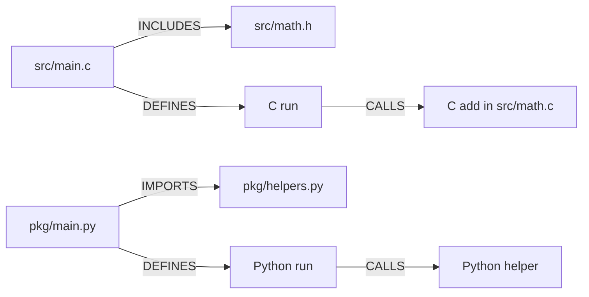

# Repository knowledge graph engine (Task 4B.1)

The shared ZIP/GitHub analysis pipeline returns `knowledge_graph` (schema `1.0`).
The backend infrastructure now feeds the Task 4B.2 client-side explorer described below.
No dedicated graph endpoints are needed. No graph database, extra dependency, network request,
source execution, model training or persistent repository storage is involved.

## Architecture and contracts

`app/analysis/graph/` contains:

- `models.py`: dataclass response contracts and `GraphIndex` lookup helpers.
- `builder.py`: deterministic entities, deduplication, bounded output and summary.
- `languages.py`: bounded C Tree-sitter/Python AST evidence and lexical bindings.
- `resolution.py`: indexed symbols, module candidates and conservative resolution.
- `engine.py`: hierarchy, shared parse-cache consumption and aggregation.

`analyze_archive` runs inventory → structure → unchanged ML inference → identity
linking → graph. Both import methods use this function. C and Python trees are
reused from the request-local structural cache. Headers are parsed separately for
includes/declarations. Function definitions and identifiers come from structural
records, not an independent function discovery implementation. No source is retained
in graph output beyond bounded reference names/expressions.

The component contains `nodes`, `edges`, `references`, `summary`, `coverage`,
`limits`, and `schema_version`. Existing analysis fields and the frontend's whole-result
JSON export remain intact. The graph is available through existing analysis responses
and JSON export; Task 4B.1 added no visualization; the Task 4B.2 section documents the frontend adapters.

## Entities, identities and direction

| Node | Evidence and metadata |
|---|---|
| `repository` | Inventory-local snapshot identity; display name and verified `source` provenance |
| `directory` | Ancestor of an inventoried file; no fabricated empty directories |
| `file` | Existing structural file ID, inventory metrics, structural status/summary |
| `function` | Existing valid structural function ID, location, metrics, hotspot reasons, ML link when present |

Only functions with valid structural analysis are retained. Invalid/bounded definitions
remain visible in the original structural component and affect graph coverage.
Unsupported-language files still participate in hierarchy.

| Directed edge | Meaning |
|---|---|
| `CONTAINS` | Repository/directory → child directory/file |
| `DEFINES` | File → function (including nested definitions and methods) |
| `CALLS` | Caller function, or supported Python module scope → function |
| `IMPORTS` | Python file → internal module file |
| `INCLUDES` | C file/header → internal included file |

Every retained edge has existing endpoints and `status=resolved_internal`. This
means supported static evidence, **not guaranteed execution or runtime binding**.
Repository/directory/edge/reference IDs use SHA-256 over canonical, domain-separated
JSON values. File/function IDs are reused verbatim from Task 4A.2. Repository identity
uses sorted inventory paths, not a content digest or upload filename. These are
snapshot-local identities; they do not guarantee stability across edits or renames,
nor distinguish every revision with identical paths.

Edges aggregate by source, target, relationship type and reference spelling.
Different aliases may therefore produce separate edges to the same target. Each edge
retains occurrence count and up to eight line/column evidence locations (1-based
lines, 0-based UTF-8 byte columns). Excess evidence is flagged. Hierarchy edges occur
once. Unresolved occurrences are separate bounded records with deterministic IDs;
identical evidence uses a deterministic duplicate ordinal. Input inventory order does
not change output ordering or identities. No temporary absolute paths are exposed.

## C resolution

Direct identifier calls resolve to a unique same-file definition first. Cross-file
calls require a declaration in the caller file or a directly included, successfully
parsed repository header, and exactly one non-static definition. Static declarations
without a local definition never bind an external function. Duplicate definitions
remain ambiguous. Prototypes do not become function nodes. Parameter/local bindings,
file-scope callback objects, known macros and indirect expressions prevent direct-call
claims. Known macros from directly included headers also block resolution.

Quoted includes prefer the caller's directory. Otherwise an exact repository path or
unique path suffix is a supported candidate, including angle-bracket includes;
multiple candidates are ambiguous. This does not establish compiler search-path
precedence. Macro include expressions are unsupported. Missing internal header parse
results conservatively prevent call resolution in that including file.

There is no C preprocessing, linker/type checking, build-flag interpretation, macro
expansion, transitive header expansion or function-pointer analysis. Conditional
compilation is not evaluated. Inline definitions in `.h` files have no structural
function records and are not extracted as graph functions. Included external headers
may introduce unknown macros; resolved calls are evidence within this limited static
model, not compilation guarantees. Malformed C files retain hierarchy/valid structural
nodes but produce no semantic references, even if individual AST fragments survived.

## Python resolution

Named function/method records retain lexical qualified names. Calls in nested
functions belong to those functions, not their parents. Module/class-body calls use
the enclosing module/function node; methods have their own nodes. Class namespaces
are not inherited as lexical method scopes.

Supported calls include direct lexical/same-module functions, recursion, imported
internal functions, aliases, module-qualified functions and relative imports.
Candidate module names come from inventory-relative paths, evidenced `__init__.py`
package chains and conventional `src/` layouts. All matching candidates are considered;
ambiguous roots, duplicate `.py`/`.pyi` modules and duplicate definitions are not guessed.
No repository module is imported and `sys.path` is never modified.

`from pkg import child` prefers an actual child module when evidenced and unambiguous;
a competing package binding remains ambiguous. `from module import function` records
a dependency on the containing module. Re-export chains are not followed. Namespace
package directory nodes are not invented as module files; imports with no concrete
module file may remain unresolved even when a qualified function call can be resolved.

Parameters, assignments/deletions, exception names, match captures, conditional
bindings, `global`/`nonlocal`, wildcard imports and duplicate bindings are handled
conservatively. Decorated definitions are not assumed to preserve callable identity.
`exec`, `eval`, namespace mutation helpers and arbitrary attribute dispatch block
supported local resolution. Comprehension calls are recorded but unresolved because
of their implicit scopes. Lambdas, definition-time defaults/annotations/decorators
and class bases are outside call coverage. Runtime monkey patching, arbitrary
`sys.path` changes, dynamic dispatch, assignment aliases, callbacks and method target
inference are not implemented. Direct recognized dynamic import expressions produce
`unsupported_dynamic` dependency records; indirect aliases of dynamic import helpers
cannot always be identified as dependencies.

## Uncertainty, structural and ML metadata

No external entity definitions are fabricated. `references` holds:

- `unresolved`: no supported unique target; **not proof of a third-party dependency**.
- `ambiguous`: competing candidates or bindings.
- `unsupported_dynamic`: indirect/dynamic/blocked binding or unsupported syntax.

These records include source node, relationship type, bounded spelling, evidence and
reason code. They are not resolved edges and have no invented target/source location.

Function metadata copies structural measurements and centralized hotspot reasons
(current thresholds: complexity ≥11, depth ≥4, span ≥80, parameters ≥6). Graph extraction
does not recompute them. C nodes reuse `ml_result_index`, `ml_status` and actual
available class/probability fields. Python, directories and unsupported files receive
no ML score. ML estimates remain uncalibrated research outputs, not confirmed defects
or vulnerabilities. Neither complexity nor graph degree is a validated defect score.
Graph extraction remains operational with missing model artifacts.

## Coverage, counters and limits

Summary counts describe **retained** nodes, unique edges and reference occurrences.
Resolved call/dependency occurrence totals are separate from unique edge totals.
`unresolved_call_references` includes all nonresolved call statuses; dependency counts
likewise include ambiguous/dynamic records. `observed_references` counts extracted
occurrences, including evidence in a file later discarded due to a limit. It is not
an estimate of undiscovered references.

Eligible files are `.c`, `.h`, `.py`, `.pyi`. Analyzed files completed supported AST
extraction; skipped files failed or hit bounds. Unsupported source files retain
hierarchy. `complete` means the defined extraction subset completed for included
source files with no coverage issue; it does not promise complete language semantics,
all runtime dependencies, or coverage of ingestion-excluded files. Unresolved references
alone do not mean parsing was incomplete. `truncated` and controlled `issues` codes
explicitly report resource loss. File work/symbol/reference failures discard that
file's semantic facts, preserving other files and hierarchy. Structural partial
coverage is also reported.

Central `GraphLimits` in `app/config.py` (no new environment variables):

| Bound | Default |
|---|---:|
| Source per file / total | 512 KiB / 8 MiB |
| Traversal per file / total | 100,000 / 400,000 AST nodes |
| Graph nodes / unique edges | 12,000 / 20,000 |
| Function index / retained symbol bindings | 4,000 each |
| Observed reference occurrences / unresolved retained | 12,000 / 4,000 |
| Evidence locations per edge / reference spelling | 8 / 256 characters |
| Serialized graph budget | 12 MiB |

Function records also obey existing structural limits (2,000 functions). Inventory
and path indexes inherit ingestion bounds (5,000 entries, depth 30, 240-byte paths).
Temporary per-file bindings are bounded by source/traversal limits; retained symbol
bindings have a separate cap. References use indexed lookup with request-local caches,
not all-pairs function matching. Traversal is iterative. Parser allocation itself is
bounded by source size, not a process-isolated hard CPU/memory deadline.

Output accounting uses non-indented ASCII-escaped JSON with a reserved 16 KiB envelope
(minimum configurable output budget). Pretty-printed JSON export may be larger but
remains bounded by these retained data limits. No graph content is executed, installed
or fetched. Existing extraction limits, containment checks and temporary cleanup
continue to apply.

## Small verified example

Use these six files (include final newlines on preprocessor directives):

```c
// src/math.h
int add(int x);
// src/math.c
int add(int x){return x+1;}
// src/main.c
#include "math.h"
#include <stdio.h>
int run(int x){printf("review");return add(x);}
```

```python
# pkg/__init__.py: empty
# pkg/helpers.py
def helper(x):
    return x
# pkg/main.py
from .helpers import helper
def run(x):
    return helper(x)
```

The actual ZIP smoke test retained 13 nodes (1 repository, 2 directories, 6 files,
4 functions), 16 edges (8 CONTAINS, 4 DEFINES, 2 CALLS, 1 IMPORTS, 1 INCLUDES), and
2 unresolved references (`stdio.h`, `printf`). All six eligible files completed,
without truncation. The local trained model analyzed the two C functions; Python
received structural/graph results only.



This diagram shows semantic edges and selected definition edges; the JSON also
contains the complete retained hierarchy. Unresolved references are not drawn as
confirmed edges.

## Reuse and local verification

`GraphIndex(graph)` offers `node(id)`, `nodes_of_type(type)`,
`incoming(id, kind=None)` and `outgoing(id, kind=None)`. Building it is O(V+E).
Future neighborhood/impact traversal must track visited IDs to handle recursion and
cycles. No impact algorithm or architecture classifier is implemented. The graph UI is described below.

```bash
source .venv/bin/activate
uvicorn app.main:app --reload
# In another terminal, after creating a small fixture ZIP:
curl --fail -F file=@/path/to/fixture.zip http://127.0.0.1:8000/api/analyze > /tmp/analysis.json
python -c 'import json; r=json.load(open("/tmp/analysis.json")); print(r["knowledge_graph"]["summary"])'
pytest tests/test_graph.py tests/test_github.py -q
pytest -q
```

Upload the same ZIP in the existing dashboard and export JSON; confirm its
`knowledge_graph` component, structural section and C-only ML results. A public GitHub
import uses the same engine; compare graph content after excluding repository-node
name/source provenance. Use the explorer below for client-side visualization.

Task 4B.1 verification: 69 focused graph cases and the complete 348-test suite passed
(0 failed, 0 skipped), including mocked GitHub/ZIP graph equivalence, existing security
regressions, unchanged structural/ML results and model-unavailable behavior. One existing
Starlette TestClient deprecation warning remains. Tests in the restricted environment
used a process-local selector polling workaround; normal local runs use the commands
above. Uvicorn completed application startup but the environment denied binding
`127.0.0.1:8765`, so browser and live-network UI verification were not performed.


## Interactive explorer (Task 4B.2)

The dashboard now consumes the existing `knowledge_graph` response entirely on the
client. No extraction or ML changes, storage or additional API endpoints were needed.
`app/static/graph/data.js` owns indexes, canonical IDs, filtering, search, bounded
neighborhoods and overlay mappings. `explorer.js` owns shared interaction state and a
text-only inspector. `svg.js` and `three.js` are interchangeable rendering adapters.
The canonical response is never mutated; the 3D library receives disposable copies.

### Modes, controls and interpretation

- **Knowledge:** retained repository/directory/file/function entities and chosen edges.
- **Function Calls:** function entities with resolved CALLS relationships.
- **Dependencies:** file entities with resolved IMPORTS/INCLUDES relationships.

Zoom, pan, fit, reset, select, drag, focus, fullscreen (or expanded CSS fallback),
search, node/relationship/language filters and one/two-hop neighborhoods operate on
actual graph results. Perspective changes do not submit another analysis. Search
spans all retained nodes even outside current filters; choosing a result opens its
bounded neighborhood, clearing incompatible type/language filters and switching to
the knowledge perspective if needed. Remaining active relationship filters still apply.
Search results and related-node buttons are the keyboard-accessible selection path in
both adapters; 2D nodes additionally support Tab/Enter/Space and arrow-key canvas pan.

Selecting a node shows applicable source location, structural metrics, hotspot reasons,
real ML metadata, incoming/outgoing relationships, evidence and unresolved references.
Missing values say Unavailable. Panel relationship/reference lists retain at most 40
entries; the rest remain in the original JSON export. Unresolved references never
become confirmed graph edges. Neither overlays nor connectivity imply vulnerabilities.

Entity visuals are fixed by type: repository diamond / size 14, directory square / 10,
file rectangle / 8, function circle / 6 in 2D; 3D uses spheres whose relative volumes
follow these size values. Sizes describe entity type, not importance. Selected nodes
are emphasized, unrelated nodes dimmed; outgoing relationships are crimson, incoming
amber. A self-loop belongs to both directions and uses outgoing color when both apply.

Complexity colors use existing bands: green 1–5, amber 6–10, crimson 11–20,
magenta ≥21; gray means unavailable. Hotspot outlines in 2D and a 1.4× volume factor
in 3D mark actual existing threshold reasons. ML colors require a genuine analyzed
C-function prediction: crimson for class 1, green for class 0, gray for unscored.
Estimated model probability appears in the inspector, with the research/uncalibrated
qualification. Python and nonfunction entities are never assigned ML predictions.

### 2D and 3D dependencies and availability

The network environment could not resolve `cdn.jsdelivr.net` or `registry.npmjs.org`.
To keep analysis usable offline, 2D uses a focused first-party SVG adapter with a
deterministic layouts and draggable positions; no force simulation or package dependency.
This is a compatibility adapter, not a custom physics engine. It makes disconnected
components visible, supports directional curved edges/self-loops and hides labels
when zoomed out. Dense graphs may still have overlapping edges; search and bounded
neighborhood focus provide the analytical path.

The real 3D adapter expects the upstream UMD bundle from **3d-force-graph 1.73.3**,
which includes its Three.js renderer and force/control dependencies. Its contract is
based on the [upstream API](https://github.com/vasturiano/3d-force-graph) and
[pinned MIT license](https://github.com/vasturiano/3d-force-graph/blob/v1.73.3/LICENSE).
There is no runtime CDN or external data service. Install explicitly from project root:

```bash
source .venv/bin/activate
python tools/install_graph_assets.py
```

The standard-library installer downloads the exact versioned npm archive, validates
its package identity, reads only bounded named members, preserves LICENSE and writes
`app/static/vendor/graph-assets.json` with source URL, hashes and bundled dependency
declarations. No npm package scripts run. The frozen prebuilt bundle needs no build
pipeline or dependency installation. Preserve license comments and the license/receipt
when redistributing assets. The receipt records downloaded bytes; it is not an independent
signature or a preverified digest. `app/static/vendor/README.md` documents attribution.

**Initial Task 4B.2 blocker:** the bundle download was blocked. At the start of the
layout/performance refinement, local 1.73.3 assets were present and their bundle hash
matched the existing receipt. They were preserved unchanged and remain untracked user
files. Actual GPU rendering is still unverified because browser startup is blocked. Missing local assets or WebGL failures report a clear
notice and fall back to functional 2D, never to a simulated 3D picture.

Capable desktop devices (fine pointer, width ≥1000px, WebGL, no reduced-motion preference)
prefer 3D on first exploration when the local dependency is available. Other devices
start in 2D; 3D remains selectable when WebGL exists. Each adapter initializes lazily
when the explorer becomes visible or is requested. Switching modes preserves selected
ID, query, perspective, filters, overlay, direction and neighborhood. Camera/drag layout
positions are adapter-local; resetting a camera/layout does not clear shared filters.

3D supplies orbit controls, right-drag camera pan, scrolling zoom, node dragging and
camera focus. The refinement uses shared, fixed deterministic spatial positions without a physics
simulation; reduced-motion mode also uses immediate camera transitions. The spatial
view uses a near-black backdrop, type-sized spheres, arrows, selected-node emphasis,
hover names and at most 31 projected labels, hidden at distance. No decorative particles
or perpetual camera motion are enabled.

### Performance and lifecycle

Rendering retains at most **180 nodes and 420 edges** at once. Initial selection is
deterministic, with selected entities retained inside the current matching subset.
Search scans the full bounded backend graph and lists up to 40 results after a 160ms
debounce. Neighborhoods are cycle-safe, one or two hops, bounded at 180 nodes and
6,000 relationship visits. Summary text distinguishes displayed, matching and total
retained counts. Backend coverage, skipped files and truncation indicators remain
visible; a displayed subset is never claimed to cover all source.

Only one rendering adapter exists at a time. Stale asynchronous library loads cannot
attach after a repository/mode switch. Repository replacement disposes the previous
adapter and resets interaction state. 2D removes pointer/keyboard/wheel listeners;
3D pauses animation, detaches controls/callbacks, releases geometry/materials/textures,
disposes renderer/context and calls the pinned component teardown. The refined adapter runs no force simulation and pauses rendering while idle/offscreen.
Canvas interaction wakes a short rendering window, and camera transitions extend that
window until completion. Only one adapter runs at once. No GPU
execution or browser performance measurement was possible in this environment.

### Verification and remaining manual checks

Automated tests exercise conversion, all filters, full-index search, cyclic/bounded
traversal, overlays/unscored values, inspector-safe text, state preservation, stale-load
cancellation, repository replacement, missing-asset/WebGL fallback, SVG listener removal,
3D disposal contracts and installer license/receipt behavior. Browser-free adapter tests
use DOM/renderer mocks and do not establish actual WebGL compatibility or visual quality.

```bash
node tests/frontend/graph.test.cjs   # Node 18+, no npm packages
pytest tests/test_graph_explorer.py -q
pytest -q
uvicorn app.main:app --reload
```

Visit `http://127.0.0.1:8000`, analyze a small mixed C/Python ZIP or public GitHub repo,
then scroll to Knowledge Graph Explorer. Check all three perspectives, filters and
search; select a hidden search result; inspect source metrics, related nodes and
unresolved references; try one/two-hop neighborhoods and overlays. In 2D verify drag,
zoom, keyboard selection and pan. After installing local assets, switch to 3D and
verify orbit, right-drag pan, node dragging, arrows, labels, camera focus, fit and
fullscreen. Confirm shared state survives mode switching and a new repository clears
old selection. Check narrow/tablet/desktop widths, reduced-motion settings, a device
without WebGL and JSON export. Existing structural and ML sections remain available.

Browser verification was attempted: Chromium exited with `setsockopt: Operation not
permitted`; Uvicorn port binding has also been blocked in this environment. No visual,
responsive or real 3D interaction success is claimed. Live GitHub verification is likewise
unavailable under the network restrictions. Architecture reconstruction, impact analysis
and assistant features remain future work.

Task 4B.2 automated verification: **354 Python tests passed, 0 failed, 0 skipped**;
the suite includes a runner for **13 passing Node frontend cases**. JavaScript syntax
checks passed. One existing Starlette TestClient deprecation warning remains. Restricted
Python test execution used the previously documented process-local selector polling
workaround. These outcomes do not replace the blocked real-browser/3D checks above.


## Layout and rendering refinement

This focused patch covers the six combinations of 2D/3D × Knowledge/Calls/Dependencies.
The graph extraction engine, ML, JSON response and export semantics are unchanged.
`layouts.js` is the shared deterministic layout/presentation module:

| Perspective | Automatic layout | Meaning |
|---|---|---|
| Knowledge | Packed hierarchy subtrees | Actual CONTAINS / DEFINES ancestry, separate sibling groups |
| Calls | Directed layers with strongly connected components | Upstream caller → downstream callee; recursion shares a component |
| Dependencies | Directory clusters | Actual parent paths; IMPORTS/INCLUDES arrows preserve direction |

The compact selector offers Automatic, Hierarchical and Radial. Explicit Hierarchical
uses containment for Knowledge and cycle-safe directed layers for semantic perspectives.
Radial uses concentric rings with minimum spacing. There is no new force-layout engine.
These are arrangements of static evidence, not inferred runtime execution sequences.
Layout changes preserve selection, filters and overlays and never reanalyze a repository.
Cycles and disconnected components remain present.

Initial knowledge graphs larger than the 180-node rendering bound collapse file groups.
`Collapse group` / `Expand group` controls work for selected directories and files;
`Focus branch` limits the view to actual descendants within the same bounds. A counter
reports nodes hidden by collapsed groups, independently of backend truncation. Search
ignores collapsed groups; selecting a hit opens its neighborhood. Changing perspective
explicitly resets entity/relationship/language filters and drops incompatible focus or
selection, with a visible notice; query, layout and overlay remain available.

Both adapters cache positions. Selection and overlay changes do not relayout entities;
subsets preserve known positions and place only newly encountered nodes. Automatic
layout changes when the perspective changes; Reset reapplies the current deterministic
layout and fits the view. Hierarchical subtrees use packed rows/columns with explicit
spacing, and a bounded neighboring-cell collision check separates overlapping positions.
Users can still intentionally drag nodes into overlapping positions.

SVG keeps keyed node/edge elements and reconciles only changed membership. Geometry,
style and viewport updates are separated; pointer motion is coalesced through one
requestAnimationFrame callback. Wheel zoom uses the pointer as anchor and aspect-aware
fit/pan coordinates. Hover/title and keyboard inspection retain complete source names.

3D uses the same layout coordinates with modest type-based plane separation; no force
simulation runs. Graph data is resubmitted only when displayed topology/layout changes.
Selection/overlay changes update presentation while retaining graph objects and fixed
positions. Pixel density is capped at 1.5, node mesh resolution is reduced, and edges
use thin lines instead of per-edge cylinders. Rendering wakes on canvas interaction,
selection or camera movement and sleeps after its short interaction/transition window.
Only up to 40 label candidates are projected, at most every 50 ms while awake; collision
checks retain up to 24 ordinary labels plus relevant selected/hovered labels. Resize,
mode/repository changes and destruction clean up scheduled frames, timers, observers,
listeners, simulation/render loops and WebGL resources.

Contextual labels prioritize selected/hovered nodes and relevant neighbors, suppress
collisions and reveal more 2D names at higher zoom. Full names remain accessible in
hover content and the inspector. Relationship base colors distinguish containment
(gray dashed), definitions (mauve dashed), calls (pale crimson), imports (green) and
includes (amber dashed in 2D; amber lines in 3D). Direct and bounded indirect outgoing
relationships are crimson; incoming are amber. Unrelated edges dim without being
removed. Curves distinguish repeated/opposite edges and self-recursion; occurrence
counts and all bounded retained evidence are available in the inspector. No unresolved
reference is promoted to a confirmed edge. Structural/ML overlays retain their original
meaning, including explicit unscored C/Python states.

The inspector groups identity, source, structural information, relationship direction,
source evidence, unresolved references and applicable ML information. Repository and
directory panels no longer display irrelevant function metrics or ML sections. Long
IDs use their own horizontally scrollable field; names/paths remain accessible without
forcing character-by-character wrapping. Only IDs use monospace.

Verification: the browser-free frontend suite exercises all six adapter/perspective
combinations, keyed SVG reuse, topology-only 3D submissions, deterministic hierarchy and
SCC layouts, collision checks, recursive/cyclic links, contextual labels, preserved
layout state, explicit filter resets, large collapsed views, bounded search, timers and
resource cleanup. These are deterministic unit/adapter checks, not GPU benchmarks.
No FPS claim is made.

Manual checks on an unrestricted machine:

```bash
source .venv/bin/activate
# Only if the local bundle is absent:
python tools/install_graph_assets.py
uvicorn app.main:app --reload
node tests/frontend/graph.test.cjs
pytest -q
```

Analyze a small repository containing nested directories, repeated calls, recursion,
Python imports and C includes. In both 2D and 3D, check Knowledge, Calls and Dependencies;
try every layout, overlays, directed one/two-hop focus, group collapse/expand, branch
focus and hidden-function search. Confirm selection does not reposition nodes, camera
fit/reset, call-site evidence, responsive controls and resource cleanup when replacing
the repository. Chromium was attempted again and failed with `setsockopt: Operation not
permitted`; actual browser, responsiveness and GPU interactions remain unverified here.

Final refinement checks: **354 Python tests passed, 0 failed, 0 skipped**, including
the frontend runner; **21 Node frontend cases passed**. JavaScript syntax and dependency
consistency checks passed. One existing Starlette TestClient deprecation warning remains.
The locally installed 3D bundle was checked against its existing receipt but was neither
modified nor staged. No FPS, GPU or real-browser interaction measurement was possible.
