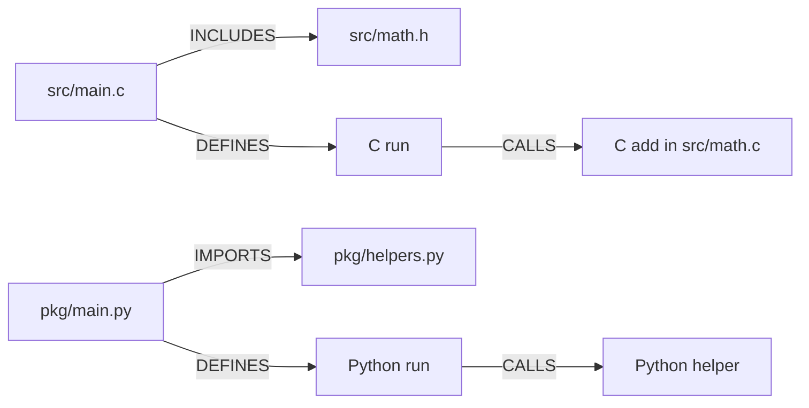

# Repository knowledge graph engine (Task 4B.1)

The shared ZIP/GitHub analysis pipeline returns `knowledge_graph` (schema `1.0`).
This is backend infrastructure; an interactive explorer and dedicated graph endpoints
are future Task 4B.2 work. No graph database, extra dependency, network request,
source execution, model training or persistent repository storage is involved.

## Architecture and contracts

`app/analysis/graph/` contains:

- `models.py`: dataclass response contracts and `GraphIndex` lookup helpers.
- `builder.py`: deterministic entities, deduplication, bounded output and summary.
- `languages.py`: bounded C Tree-sitter/Python AST evidence and lexical bindings.
- `resolution.py`: indexed symbols, module candidates and conservative resolution.
- `engine.py`: hierarchy, shared parse-cache consumption and aggregation.

`analyze_archive` runs inventory → structure → unchanged ML inference → identity
linking → graph. Both import methods use this function. C and Python trees are
reused from the request-local structural cache. Headers are parsed separately for
includes/declarations. Function definitions and identifiers come from structural
records, not an independent function discovery implementation. No source is retained
in graph output beyond bounded reference names/expressions.

The component contains `nodes`, `edges`, `references`, `summary`, `coverage`,
`limits`, and `schema_version`. Existing analysis fields and the frontend's whole-result
JSON export remain intact. The graph is available through existing analysis responses
and JSON export; this task adds no graph visualization or frontend dependency.

## Entities, identities and direction

| Node | Evidence and metadata |
|---|---|
| `repository` | Inventory-local snapshot identity; display name and verified `source` provenance |
| `directory` | Ancestor of an inventoried file; no fabricated empty directories |
| `file` | Existing structural file ID, inventory metrics, structural status/summary |
| `function` | Existing valid structural function ID, location, metrics, hotspot reasons, ML link when present |

Only functions with valid structural analysis are retained. Invalid/bounded definitions
remain visible in the original structural component and affect graph coverage.
Unsupported-language files still participate in hierarchy.

| Directed edge | Meaning |
|---|---|
| `CONTAINS` | Repository/directory → child directory/file |
| `DEFINES` | File → function (including nested definitions and methods) |
| `CALLS` | Caller function, or supported Python module scope → function |
| `IMPORTS` | Python file → internal module file |
| `INCLUDES` | C file/header → internal included file |

Every retained edge has existing endpoints and `status=resolved_internal`. This
means supported static evidence, **not guaranteed execution or runtime binding**.
Repository/directory/edge/reference IDs use SHA-256 over canonical, domain-separated
JSON values. File/function IDs are reused verbatim from Task 4A.2. Repository identity
uses sorted inventory paths, not a content digest or upload filename. These are
snapshot-local identities; they do not guarantee stability across edits or renames,
nor distinguish every revision with identical paths.

Edges aggregate by source, target, relationship type and reference spelling.
Different aliases may therefore produce separate edges to the same target. Each edge
retains occurrence count and up to eight line/column evidence locations (1-based
lines, 0-based UTF-8 byte columns). Excess evidence is flagged. Hierarchy edges occur
once. Unresolved occurrences are separate bounded records with deterministic IDs;
identical evidence uses a deterministic duplicate ordinal. Input inventory order does
not change output ordering or identities. No temporary absolute paths are exposed.

## C resolution

Direct identifier calls resolve to a unique same-file definition first. Cross-file
calls require a declaration in the caller file or a directly included, successfully
parsed repository header, and exactly one non-static definition. Static declarations
without a local definition never bind an external function. Duplicate definitions
remain ambiguous. Prototypes do not become function nodes. Parameter/local bindings,
file-scope callback objects, known macros and indirect expressions prevent direct-call
claims. Known macros from directly included headers also block resolution.

Quoted includes prefer the caller's directory. Otherwise an exact repository path or
unique path suffix is a supported candidate, including angle-bracket includes;
multiple candidates are ambiguous. This does not establish compiler search-path
precedence. Macro include expressions are unsupported. Missing internal header parse
results conservatively prevent call resolution in that including file.

There is no C preprocessing, linker/type checking, build-flag interpretation, macro
expansion, transitive header expansion or function-pointer analysis. Conditional
compilation is not evaluated. Inline definitions in `.h` files have no structural
function records and are not extracted as graph functions. Included external headers
may introduce unknown macros; resolved calls are evidence within this limited static
model, not compilation guarantees. Malformed C files retain hierarchy/valid structural
nodes but produce no semantic references, even if individual AST fragments survived.

## Python resolution

Named function/method records retain lexical qualified names. Calls in nested
functions belong to those functions, not their parents. Module/class-body calls use
the enclosing module/function node; methods have their own nodes. Class namespaces
are not inherited as lexical method scopes.

Supported calls include direct lexical/same-module functions, recursion, imported
internal functions, aliases, module-qualified functions and relative imports.
Candidate module names come from inventory-relative paths, evidenced `__init__.py`
package chains and conventional `src/` layouts. All matching candidates are considered;
ambiguous roots, duplicate `.py`/`.pyi` modules and duplicate definitions are not guessed.
No repository module is imported and `sys.path` is never modified.

`from pkg import child` prefers an actual child module when evidenced and unambiguous;
a competing package binding remains ambiguous. `from module import function` records
a dependency on the containing module. Re-export chains are not followed. Namespace
package directory nodes are not invented as module files; imports with no concrete
module file may remain unresolved even when a qualified function call can be resolved.

Parameters, assignments/deletions, exception names, match captures, conditional
bindings, `global`/`nonlocal`, wildcard imports and duplicate bindings are handled
conservatively. Decorated definitions are not assumed to preserve callable identity.
`exec`, `eval`, namespace mutation helpers and arbitrary attribute dispatch block
supported local resolution. Comprehension calls are recorded but unresolved because
of their implicit scopes. Lambdas, definition-time defaults/annotations/decorators
and class bases are outside call coverage. Runtime monkey patching, arbitrary
`sys.path` changes, dynamic dispatch, assignment aliases, callbacks and method target
inference are not implemented. Direct recognized dynamic import expressions produce
`unsupported_dynamic` dependency records; indirect aliases of dynamic import helpers
cannot always be identified as dependencies.

## Uncertainty, structural and ML metadata

No external entity definitions are fabricated. `references` holds:

- `unresolved`: no supported unique target; **not proof of a third-party dependency**.
- `ambiguous`: competing candidates or bindings.
- `unsupported_dynamic`: indirect/dynamic/blocked binding or unsupported syntax.

These records include source node, relationship type, bounded spelling, evidence and
reason code. They are not resolved edges and have no invented target/source location.

Function metadata copies structural measurements and centralized hotspot reasons
(current thresholds: complexity ≥11, depth ≥4, span ≥80, parameters ≥6). Graph extraction
does not recompute them. C nodes reuse `ml_result_index`, `ml_status` and actual
available class/probability fields. Python, directories and unsupported files receive
no ML score. ML estimates remain uncalibrated research outputs, not confirmed defects
or vulnerabilities. Neither complexity nor graph degree is a validated defect score.
Graph extraction remains operational with missing model artifacts.

## Coverage, counters and limits

Summary counts describe **retained** nodes, unique edges and reference occurrences.
Resolved call/dependency occurrence totals are separate from unique edge totals.
`unresolved_call_references` includes all nonresolved call statuses; dependency counts
likewise include ambiguous/dynamic records. `observed_references` counts extracted
occurrences, including evidence in a file later discarded due to a limit. It is not
an estimate of undiscovered references.

Eligible files are `.c`, `.h`, `.py`, `.pyi`. Analyzed files completed supported AST
extraction; skipped files failed or hit bounds. Unsupported source files retain
hierarchy. `complete` means the defined extraction subset completed for included
source files with no coverage issue; it does not promise complete language semantics,
all runtime dependencies, or coverage of ingestion-excluded files. Unresolved references
alone do not mean parsing was incomplete. `truncated` and controlled `issues` codes
explicitly report resource loss. File work/symbol/reference failures discard that
file's semantic facts, preserving other files and hierarchy. Structural partial
coverage is also reported.

Central `GraphLimits` in `app/config.py` (no new environment variables):

| Bound | Default |
|---|---:|
| Source per file / total | 512 KiB / 8 MiB |
| Traversal per file / total | 100,000 / 400,000 AST nodes |
| Graph nodes / unique edges | 12,000 / 20,000 |
| Function index / retained symbol bindings | 4,000 each |
| Observed reference occurrences / unresolved retained | 12,000 / 4,000 |
| Evidence locations per edge / reference spelling | 8 / 256 characters |
| Serialized graph budget | 12 MiB |

Function records also obey existing structural limits (2,000 functions). Inventory
and path indexes inherit ingestion bounds (5,000 entries, depth 30, 240-byte paths).
Temporary per-file bindings are bounded by source/traversal limits; retained symbol
bindings have a separate cap. References use indexed lookup with request-local caches,
not all-pairs function matching. Traversal is iterative. Parser allocation itself is
bounded by source size, not a process-isolated hard CPU/memory deadline.

Output accounting uses non-indented ASCII-escaped JSON with a reserved 16 KiB envelope
(minimum configurable output budget). Pretty-printed JSON export may be larger but
remains bounded by these retained data limits. No graph content is executed, installed
or fetched. Existing extraction limits, containment checks and temporary cleanup
continue to apply.

## Small verified example

Use these six files (include final newlines on preprocessor directives):

```c
// src/math.h
int add(int x);
// src/math.c
int add(int x){return x+1;}
// src/main.c
#include "math.h"
#include <stdio.h>
int run(int x){printf("review");return add(x);}
```

```python
# pkg/__init__.py: empty
# pkg/helpers.py
def helper(x):
    return x
# pkg/main.py
from .helpers import helper
def run(x):
    return helper(x)
```

The actual ZIP smoke test retained 13 nodes (1 repository, 2 directories, 6 files,
4 functions), 16 edges (8 CONTAINS, 4 DEFINES, 2 CALLS, 1 IMPORTS, 1 INCLUDES), and
2 unresolved references (`stdio.h`, `printf`). All six eligible files completed,
without truncation. The local trained model analyzed the two C functions; Python
received structural/graph results only.



This diagram shows semantic edges and selected definition edges; the JSON also
contains the complete retained hierarchy. Unresolved references are not drawn as
confirmed edges.

## Reuse and local verification

`GraphIndex(graph)` offers `node(id)`, `nodes_of_type(type)`,
`incoming(id, kind=None)` and `outgoing(id, kind=None)`. Building it is O(V+E).
Future neighborhood/impact traversal must track visited IDs to handle recursion and
cycles. No impact algorithm, architecture classifier or graph UI is implemented here.

```bash
source .venv/bin/activate
uvicorn app.main:app --reload
# In another terminal, after creating a small fixture ZIP:
curl --fail -F file=@/path/to/fixture.zip http://127.0.0.1:8000/api/analyze > /tmp/analysis.json
python -c 'import json; r=json.load(open("/tmp/analysis.json")); print(r["knowledge_graph"]["summary"])'
pytest tests/test_graph.py tests/test_github.py -q
pytest -q
```

Upload the same ZIP in the existing dashboard and export JSON; confirm its
`knowledge_graph` component, structural section and C-only ML results. A public GitHub
import uses the same engine; compare graph content after excluding repository-node
name/source provenance. Interactive visualization is intentionally absent.

Task 4B.1 verification: 69 focused graph cases and the complete 348-test suite passed
(0 failed, 0 skipped), including mocked GitHub/ZIP graph equivalence, existing security
regressions, unchanged structural/ML results and model-unavailable behavior. One existing
Starlette TestClient deprecation warning remains. Tests in the restricted environment
used a process-local selector polling workaround; normal local runs use the commands
above. Uvicorn completed application startup but the environment denied binding
`127.0.0.1:8765`, so browser and live-network UI verification were not performed.
